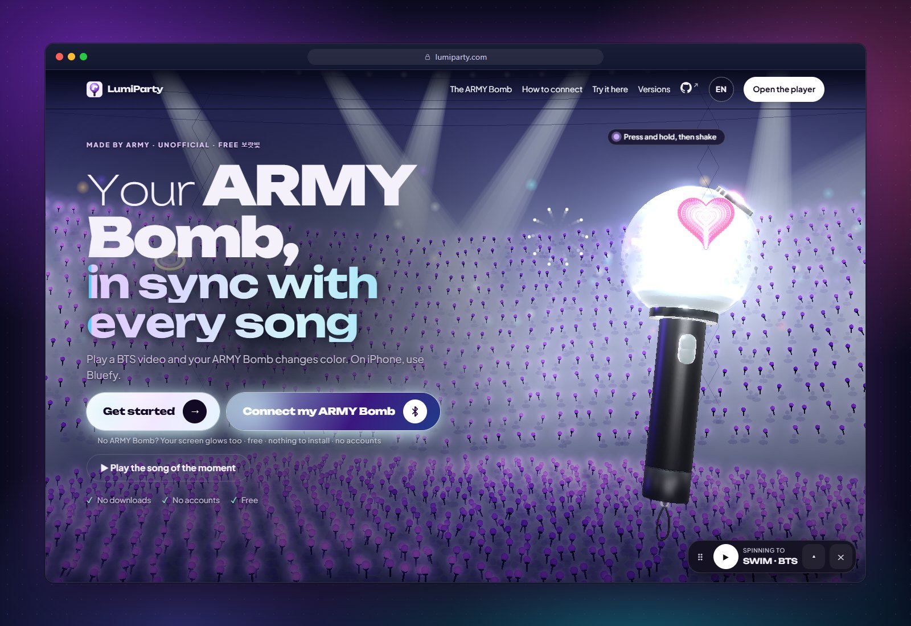
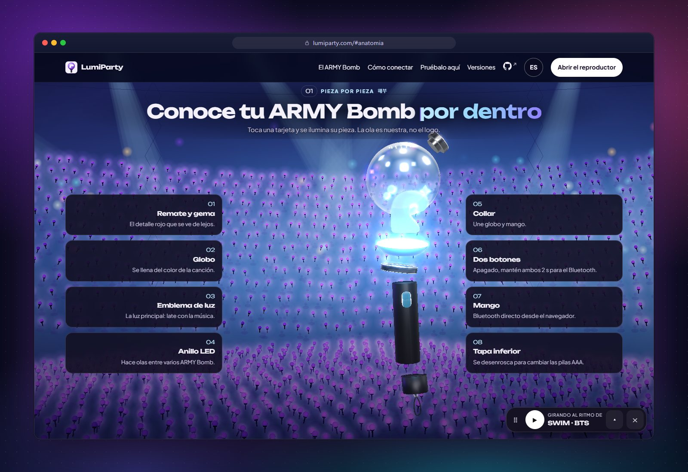
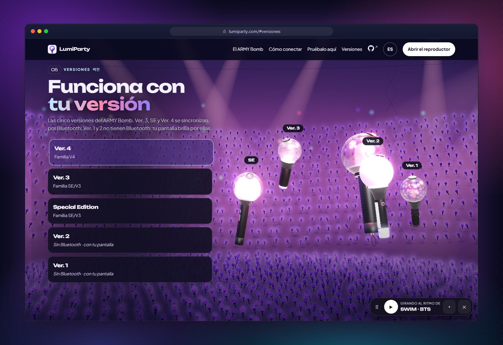
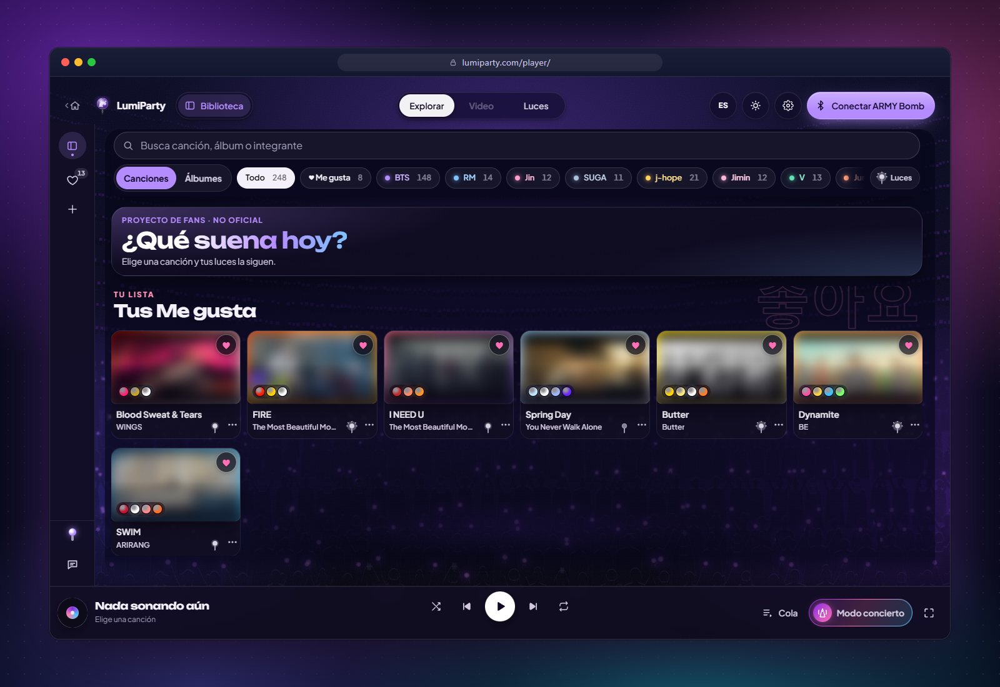
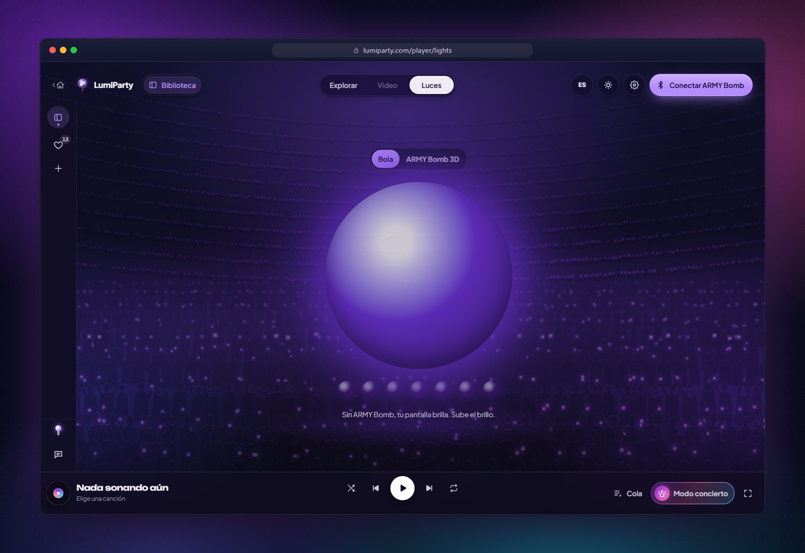
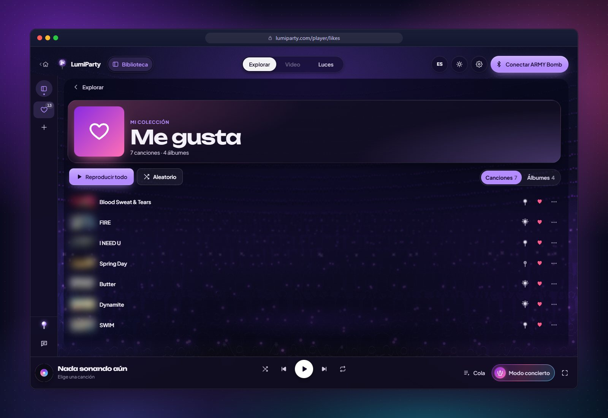
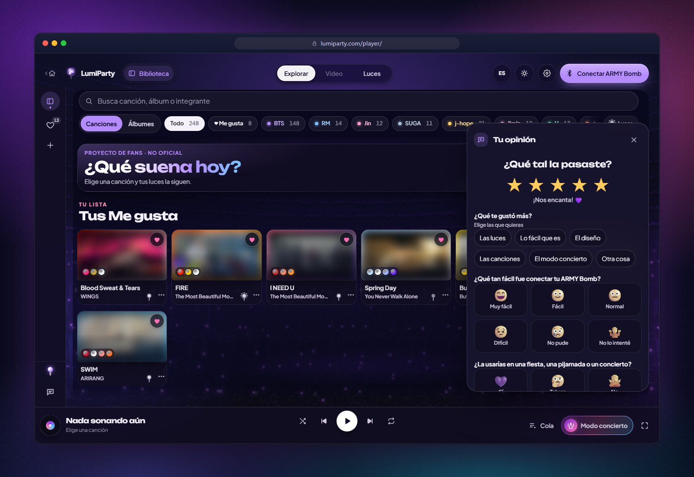
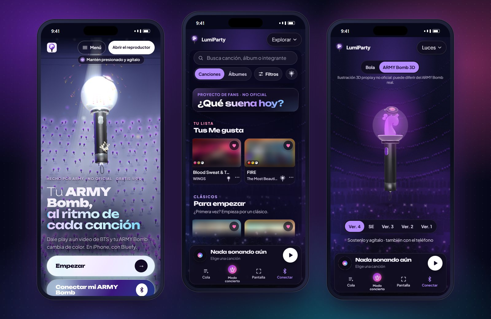
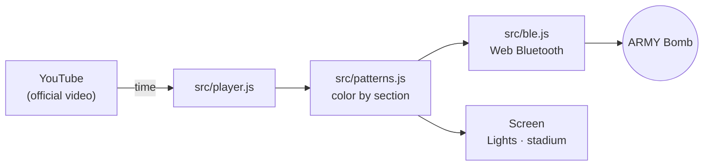

<p align="center">
  <a href="README.md">Español</a> ·
  <b>🌐 English</b> ·
  <a href="README.pt-BR.md">Português (Brasil)</a> ·
  <a href="README.ko.md">한국어</a> ·
  <a href="README.id.md">Bahasa Indonesia</a>
</p>

<div align="center">

<a href="https://lumiparty.com/"></a>

# LumiParty

**Your ARMY Bomb, in sync with every song.**

A free, open-source fan website that syncs your lightstick over Bluetooth with BTS's official videos.
Nothing to install, no accounts.

<a href="https://lumiparty.com/"></a>
<a href="LICENSE"></a>


<br>


<a href="https://github.com/KarlaMedina97/lightstick-bts-concert-sync/stargazers"></a>

</div>

<br>

Hit play on a BTS video and your **ARMY Bomb** changes color with the intro, the chorus and the bridge, just like at the
stadium. If you don't have one on hand, **your screen glows for it**. Everything happens in the browser: it's a progressive
web app (PWA) you can install, and it opens offline.

> [!NOTE]
> An **unofficial** fan project, not affiliated with HYBE, BIGHIT MUSIC or BTS. Videos play from official YouTube
> channels; this repository contains no audio, video or lyrics.

<p align="center">
  <a href="https://lumiparty.com/"></a>
</p>

## 📑 Contents

- [✨ Features](#features)
- [📱 Compatibility](#compatibility)
- [🚀 How to use](#how-to-use)
- [🛠️ Development](#development)
- [🧱 Architecture](#architecture)
- [🔒 Privacy](#privacy)
- [⚖️ Legal notice](#legal-notice)
- [🤝 Contributing](#contributing)
- [💜 Support](#support)
- [📄 License](#license)
- [🌐 Other languages](#languages)

<a id="features"></a>

## ✨ Features

<table>
  <tr>
    <td width="50%" valign="top">
      
      <h3>🔍 Piece by piece</h3>
      A 3D ARMY Bomb (our own illustration, with an original wave emblem) that comes apart as you scroll.
      Tap a card and its piece lights up.
    </td>
    <td width="50%" valign="top">
      
      <h3>🪄 All five versions</h3>
      Ver. 4, SE and Ver. 3 connect over Bluetooth. Ver. 2 and Ver. 1 don't have Bluetooth: your screen glows for them.
    </td>
  </tr>
  <tr>
    <td width="50%" valign="top">
      
      <h3>🎵 Explore</h3>
      Songs grouped by album, from the group and from each member, with search and filters. When a song ends,
      the next one starts.
    </td>
    <td width="50%" valign="top">
      
      <h3>💡 Lights</h3>
      A giant ball of light (or the 3D ARMY Bomb) in the color of each moment. No ARMY Bomb? Your screen is your lightstick.
    </td>
  </tr>
  <tr>
    <td width="50%" valign="top">
      
      <h3>💜 Liked</h3>
      Save songs and albums with ♡ and play them in order or on shuffle. They're saved only on your device.
    </td>
    <td width="50%" valign="top">
      
      <h3>⭐ Your feedback</h3>
      Stars first; then, depending on your rating, a few questions with visual options. Anonymous and done in seconds.
    </td>
  </tr>
</table>

<p align="center">
  
  <br><sub>On a phone: home, Explore and the 3D ARMY Bomb in <i>Lights</i>.</sub>
</p>

**And also:**

| | |
| --- | --- |
| 🎛️ **Concert lights** | Patterns generated in your browser from each song's section, energy and palette. |
| 🌊 **Waves** | With several ARMY Bombs connected, each one runs slightly behind the last, like a stadium wave. |
| 🏟️ **Concert mode** | *At the stadium*: the camera copies the color of the ARMY Bombs around you. *On TV*: the microphone follows the music in the room (for concerts on paid platforms). Nothing is recorded. |
| 📣 **Fanchant** | Between songs, the members' names appear in hangul and romanized. You can skip it or turn it off. |
| 🎬 **My videos** | Add videos from official YouTube channels and sync them the same way. |
| 🧭 **Connection guide** | Four animated, narrated steps, like the announcements before a concert. |
| ♿ **For every ARMY** | Safe mode on (max. 3 flashes per second, WCAG 2.3.1), keyboard, screen reader and `prefers-reduced-motion`. |
| 🌐 **Five languages** | Español, English, Português (Brasil), 한국어 and Bahasa Indonesia. |
| 📲 **Installable** | PWA with a service worker: opens offline (videos do need internet). |

<a id="compatibility"></a>

## 📱 Compatibility

| Platform | Videos and on-screen lights | ARMY Bomb over Bluetooth |
| --- | :---: | :---: |
| Android: Chrome, Edge | ✅ | ✅ |
| Windows, macOS, ChromeOS, Linux: Chrome, Edge | ✅ | ✅ |
| Brave | ✅ | ⚠️ You need to enable Web Bluetooth in `brave://flags` (the app explains how) |
| Firefox, Safari on Mac | ✅ | ❌ No Web Bluetooth |
| iPhone / iPad: Safari | ✅ | ❌ Apple doesn't allow Bluetooth on the web |
| iPhone / iPad: [Bluefy](https://apps.apple.com/app/id1492822055) (free) | ✅ | ✅ |

| ARMY Bomb version | How it works |
| --- | --- |
| **Ver. 4** | Bluetooth (V4 family) |
| **Special Edition** and **Ver. 3** | Bluetooth (SE/V3 family) |
| **Ver. 2** and **Ver. 1** | No Bluetooth: your screen glows with the song |

> [!TIP]
> Web Bluetooth needs `https://` or `localhost`. The protocol is documented in
> [docs/protocolo-ble.md](docs/protocolo-ble.md). It hasn't been tested with every hardware model yet: if your
> ARMY Bomb won't connect, [open an issue](https://github.com/KarlaMedina97/lightstick-bts-concert-sync/issues).

<a id="how-to-use"></a>

## 🚀 How to use

1. Open **[lumiparty.com](https://lumiparty.com/)** in Chrome or Edge (on iPhone, in Bluefy) and tap **Get started**.
2. Pick a song in **Explore**. Your screen is already glowing with it.
3. Got an ARMY Bomb? Tap **Connect my ARMY Bomb** and follow the 4-step guide: with the ARMY Bomb turned off,
   hold down both of its buttons for about 2 seconds so it enters Bluetooth mode, then pick it from the list.
4. Switch between **Video** and **Lights** whenever you like. In **Settings** you can change the brightness, the light
   delay and the style; the language, from the language button.
5. Concert on TV or at the stadium? Open **Concert mode**.

To have it as an app, use *Install* or *Add to Home Screen* in your browser.

<a id="development"></a>

## 🛠️ Development

A static site with no build step and no npm dependencies: modern JavaScript with native ES modules, and three.js and GSAP
copied into `vendor/`. All you need is [Node.js](https://nodejs.org) 22 or later.

```bash
git clone https://github.com/KarlaMedina97/lightstick-bts-concert-sync.git
cd lightstick-bts-concert-sync
npm run dev        # http://localhost:5173
```

| Command | What it does |
| --- | --- |
| `npm run dev` | Local server at http://localhost:5173 (`npm run dev:lan` to test on your phone) |
| `npm test` | Unit tests (`node --test`) |
| `npm run csp` | Regenerates the pages' Content-Security-Policy |
| `npm run check` | Tests + up-to-date CSP + build: the same thing CI runs |
| `npm run check:ui` | Test in a real headless browser (390 and 1440 px): exceptions, horizontal scroll, sticky anatomy, icons. Leaves screenshots in `.ui-check/` |
| `npm run check:embeds` | Checks that every video in the catalog can be played inside the page |
| `npm run check:commits` | Checks commit messages against `origin/main` |
| `npm run build` | Builds `_site/` with only what gets published |

Enable, once, the hook that runs `check:ui` before every push:

```bash
git config core.hooksPath .githooks
```

The site is published to GitHub Pages from `.github/workflows/ci.yml` on every push to `main`. The project's full
rules (legal, security, language, accessibility) are in [CLAUDE.md](CLAUDE.md).

<a id="architecture"></a>

## 🧱 Architecture

```
index.html · landing.css · src/landing.js    3D home (three.js + GSAP): ARMY Bomb, anatomy, versions, stadium
player/index.html · styles.css · src/app.js  Player: Explore, Video, Lights, Liked, My videos, panels
src/ble.js                                   Web Bluetooth: discovery, V4 and SE/V3 families, write pacing
src/player.js                                YouTube player with an interpolated clock
src/patterns.js                              Section-based light patterns and per-song looks
src/catalog.js                               Albums, songs (official videos) and concerts
src/stick3d.js                               3D ARMY Bomb for the Lights view
src/camera.js · src/mic.js                   Concert mode: camera and microphone (all on the device)
src/fanchant.js · src/crowd.js               Fanchant between songs and canvas crowd
src/guide.js · src/tour.js                   Connection guide and welcome tour
src/favorites.js · src/feedback.js           Liked and feedback
src/i18n.js · src/i18n/                      Spanish (source) + en, pt-BR, ko, id
sw.js · manifest.webmanifest                 PWA: offline cache and installation
vendor/ · fonts/                             three.js, GSAP and fonts served locally (no CDNs)
scripts/ · tests/                            Local server, CSP, build, tests and check:ui
```



<a id="privacy"></a>

## 🔒 Privacy

- **No accounts and no server of our own.** Liked songs, settings and history are saved only on your device and can be deleted from *Settings*.
- **Cookieless Google Analytics 4**: only pages visited and events with fixed names, with anonymized IP and no ad
  signals. It doesn't load with *Do Not Track* or *Global Privacy Control*, or on localhost.
- **Camera and microphone** are processed on the device: nothing is recorded or sent.
- YouTube in privacy-enhanced mode (`youtube-nocookie.com`), a Content-Security-Policy on every page, and libraries
  served from `vendor/`.

Details in the [privacy policy](https://lumiparty.com/privacy/) and in [SECURITY.md](SECURITY.md).

<a id="legal-notice"></a>

## ⚖️ Legal notice

LumiParty is an **unofficial fan project**. It is not affiliated with, sponsored by or endorsed by HYBE, BIGHIT MUSIC,
BTS or the makers of the ARMY Bomb. BTS, ARMY Bomb and the names of artists, albums and songs are trademarks or
property of their respective owners and are used only to identify the music.

- The repository **contains no** official lyrics, audio, video or logos. Videos are watched from official YouTube
  channels with YouTube's own player; the thumbnails in this README's screenshots are blurred on purpose.
- The 3D ARMY Bomb is our own illustration with an original wave-shaped emblem.
- The Bluetooth protocol was documented for interoperability; the implementation is our own.

Are you a rights holder and want something taken down? [Open an issue](https://github.com/KarlaMedina97/lightstick-bts-concert-sync/issues)
and we'll handle it as soon as possible.

<a id="contributing"></a>

## 🤝 Contributing

All help is welcome! Read [CONTRIBUTING.md](CONTRIBUTING.md) before you start.

- **Commits** using [Conventional Commits](https://www.conventionalcommits.org/es/) in Spanish: `feat(luces): …`, `fix(ble): …`.
- **New songs**: only videos from official channels, with rich lights (the quality check in `tests/looks.test.js`
  requires it). See [docs/patrones-luces.md](docs/patrones-luces.md).
- **Visible text** in Spanish, with its translation in `src/i18n/`.
- Before opening the pull request: `npm run check` and, if you touch the interface, `npm run check:ui`.

Tried it with your ARMY Bomb? Tell us how it went from **Your feedback** inside the app.

<a id="support"></a>

## 💜 Support

LumiParty is free and always will be. If you like it, you can:

- leave a ⭐ on the repository,
- support development through [GitHub Sponsors](https://github.com/sponsors/KarlaMedina97),
- share it with other ARMY.

<a id="license"></a>

## 📄 License

[MIT](LICENSE) © Karla Medina, for the project's own code.

**It does not cover `vendor/gsap/`**: GSAP 3.13.0 is used under GreenSock's "no charge" Standard license
(see [`vendor/gsap/LICENSE.txt`](vendor/gsap/LICENSE.txt) and https://gsap.com/standard-license). three.js keeps its
MIT license ([`vendor/README.md`](vendor/README.md)) and the Unbounded and Plus Jakarta Sans fonts keep the SIL Open Font
License (see [`fonts/`](fonts/)).

<a id="languages"></a>

## 🌐 Other languages

This README is also available in [Español](README.md) · [Português (Brasil)](README.pt-BR.md) · [한국어](README.ko.md) ·
[Bahasa Indonesia](README.id.md), the same languages as the app.

<div align="center">
<br>
<sub>Made with 💜 by ARMY · <a href="https://lumiparty.com/">lumiparty.com</a></sub>
</div>
