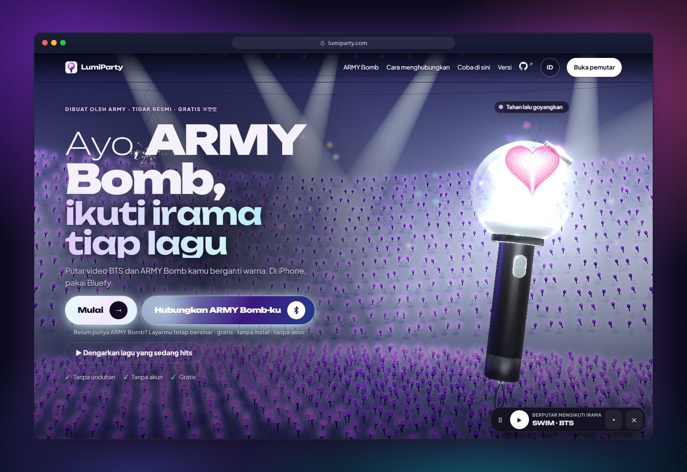
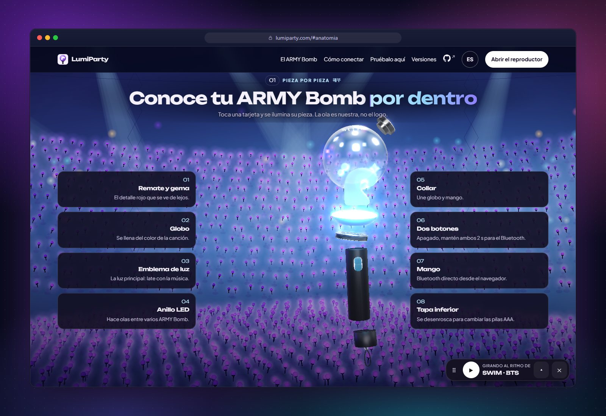
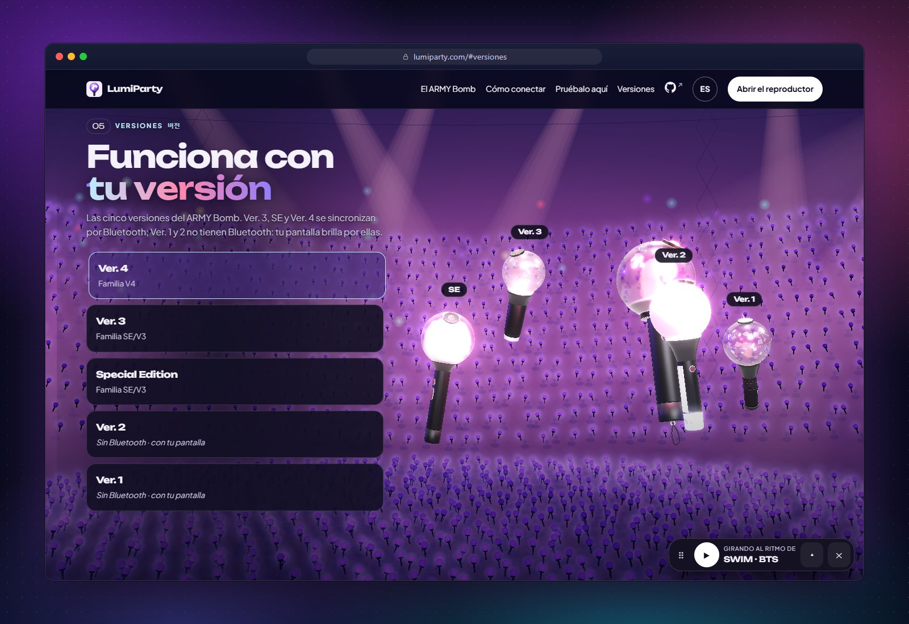
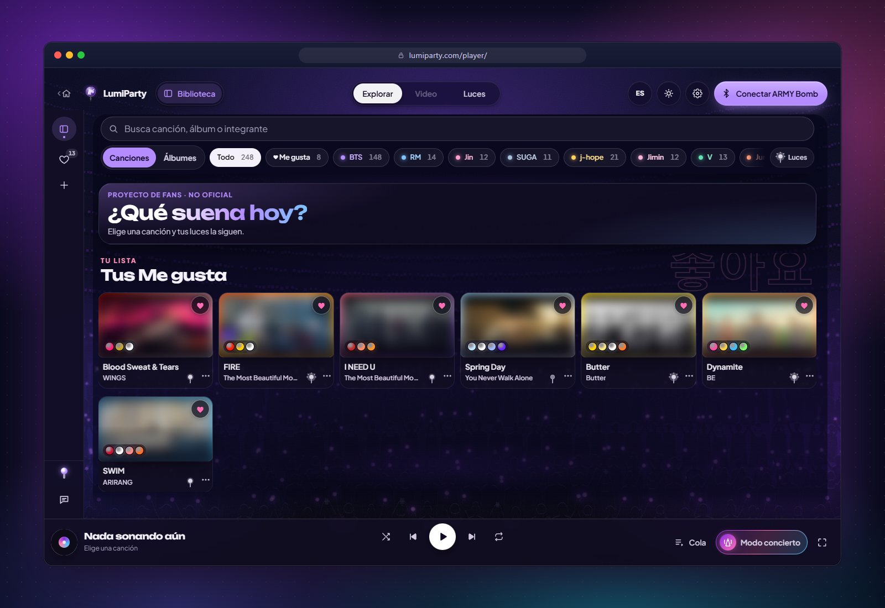
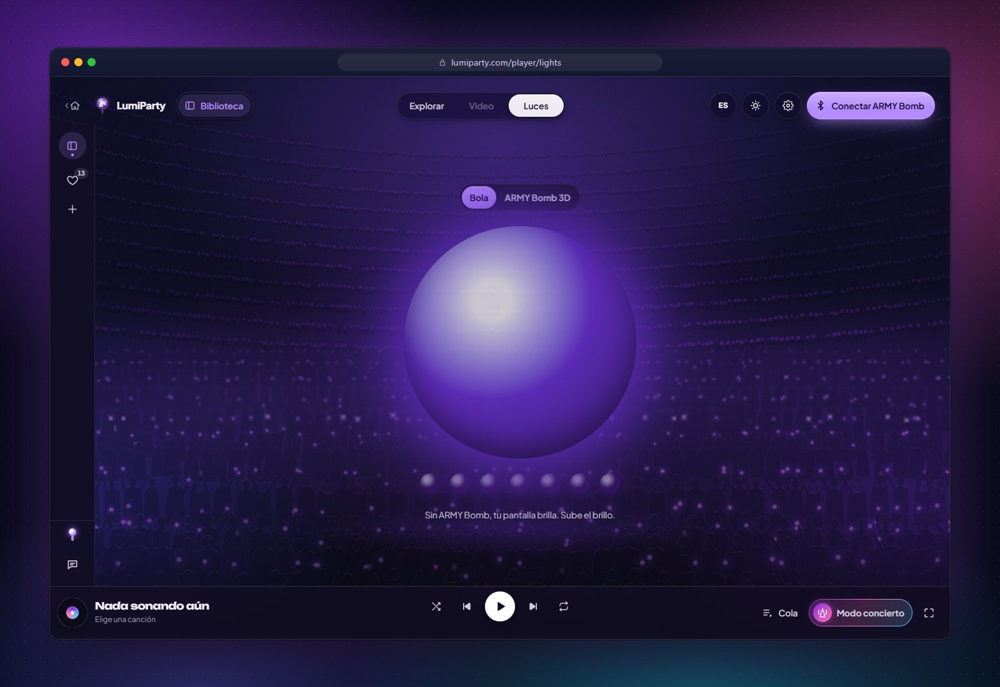
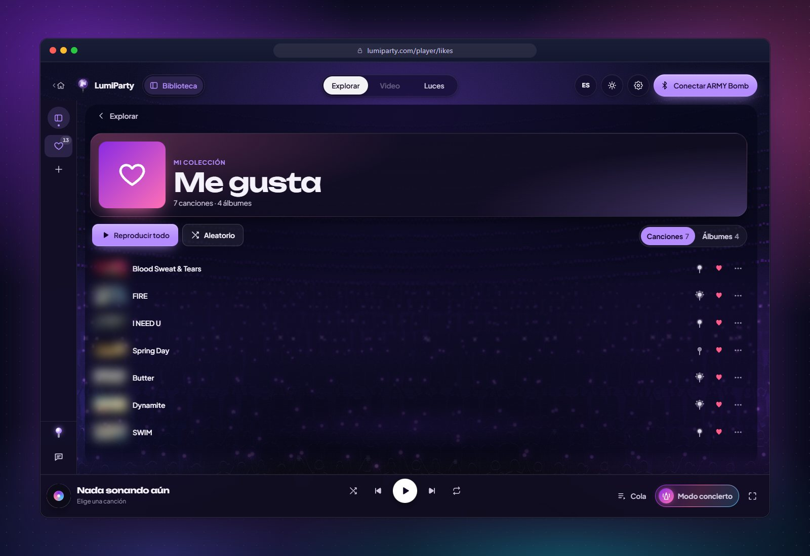
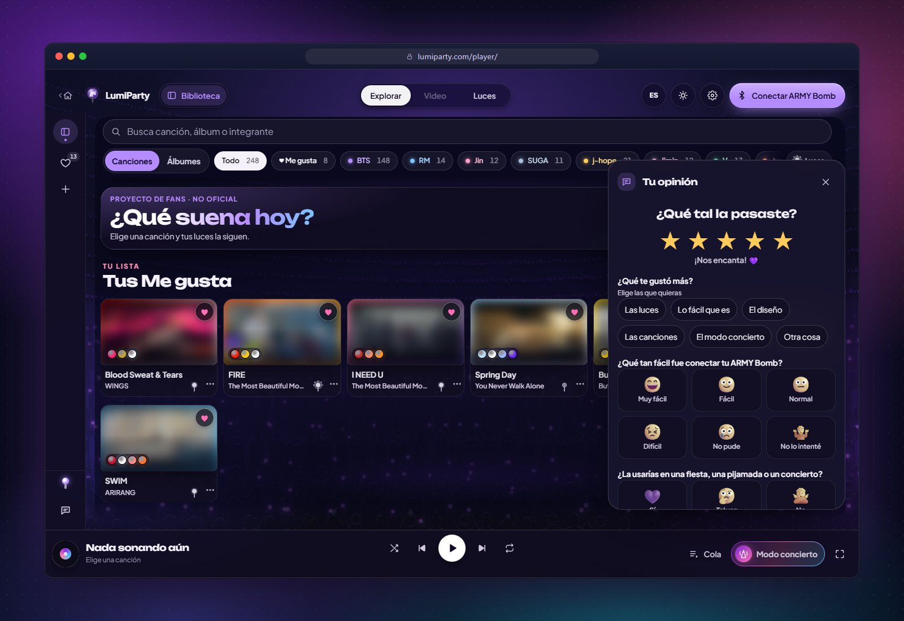
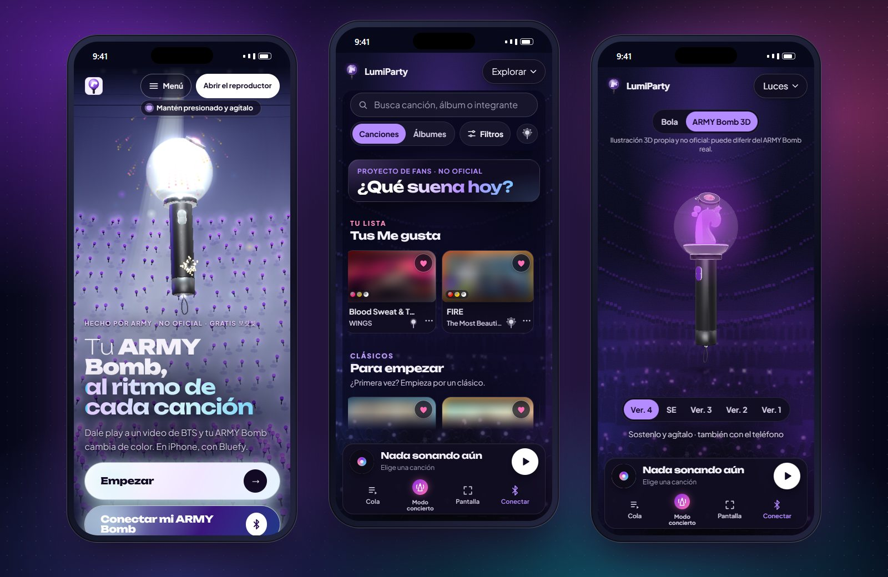
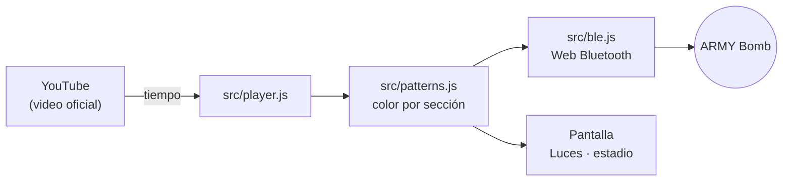

<p align="center">
  <a href="README.md">Español</a> ·
  <a href="README.en.md">English</a> ·
  <a href="README.pt-BR.md">Português (Brasil)</a> ·
  <a href="README.ko.md">한국어</a> ·
  <b>🌐 Bahasa Indonesia</b>
</p>

<div align="center">

<a href="https://lumiparty.com/"></a>

# LumiParty

**ARMY Bomb-mu, mengikuti irama setiap lagu.**

Halaman web penggemar yang gratis dan open source, yang menyinkronkan lightstick-mu lewat Bluetooth dengan video resmi BTS.
Tanpa instalasi, tanpa akun.

<a href="https://lumiparty.com/"></a>
<a href="LICENSE"></a>


<br>


<a href="https://github.com/KarlaMedina97/lightstick-bts-concert-sync/stargazers"></a>

</div>

<br>

Putar video BTS dan **ARMY Bomb**-mu berganti warna mengikuti intro, reff, dan bridge, seperti di
stadion. Kalau tidak sedang memegangnya, **layarmu yang bersinar menggantikannya**. Semuanya berjalan di browser:
ini adalah progressive web app (PWA) yang bisa dipasang dan dibuka tanpa koneksi internet.

> [!NOTE]
> Proyek penggemar **tidak resmi**, tidak berafiliasi dengan HYBE, BIGHIT MUSIC, maupun BTS. Video diputar dari
> kanal resmi YouTube; repositori ini tidak berisi audio, video, maupun lirik.

<p align="center">
  <a href="https://lumiparty.com/"></a>
</p>

## 📑 Daftar isi

- [✨ Fitur](#fitur)
- [📱 Kompatibilitas](#kompatibilitas)
- [🚀 Cara menggunakan](#cara-menggunakan)
- [🛠️ Pengembangan](#pengembangan)
- [🧱 Arsitektur](#arsitektur)
- [🔒 Privasi](#privasi)
- [⚖️ Pemberitahuan hukum](#pemberitahuan-hukum)
- [🤝 Berkontribusi](#berkontribusi)
- [💜 Dukungan](#dukungan)
- [📄 Lisensi](#lisensi)
- [🌐 Bahasa lain](#bahasa)

<a id="fitur"></a>

## ✨ Fitur

<table>
  <tr>
    <td width="50%" valign="top">
      
      <h3>🔍 Satu per satu</h3>
      ARMY Bomb 3D (ilustrasi buatan sendiri, dengan emblem ombak orisinal) yang terurai saat kamu menggulir.
      Ketuk sebuah kartu dan bagiannya akan menyala.
    </td>
    <td width="50%" valign="top">
      
      <h3>🪄 Lima versi</h3>
      Ver. 4, SE, dan Ver. 3 terhubung lewat Bluetooth. Ver. 2 dan Ver. 1 tidak punya Bluetooth: layarmu yang bersinar menggantikannya.
    </td>
  </tr>
  <tr>
    <td width="50%" valign="top">
      
      <h3>🎵 Jelajahi</h3>
      Lagu dikelompokkan per album, dari grup maupun tiap member, dengan pencarian dan filter. Saat satu
      lagu selesai, lagu berikutnya dimulai.
    </td>
    <td width="50%" valign="top">
      
      <h3>💡 Lampu</h3>
      Bola cahaya raksasa (atau ARMY Bomb 3D) dengan warna setiap momen. Tanpa ARMY Bomb, layarmu jadi lightstick-mu.
    </td>
  </tr>
  <tr>
    <td width="50%" valign="top">
      
      <h3>💜 Disukai</h3>
      Simpan lagu dan album dengan ♡ lalu putar berurutan atau acak. Hanya tersimpan di perangkatmu.
    </td>
    <td width="50%" valign="top">
      
      <h3>⭐ Pendapatmu</h3>
      Pertama bintang; lalu, tergantung nilainya, beberapa pertanyaan dengan pilihan visual. Anonim dan hanya beberapa detik.
    </td>
  </tr>
</table>

<p align="center">
  
  <br><sub>Di ponsel: beranda, Jelajahi, dan ARMY Bomb 3D di <i>Lampu</i>.</sub>
</p>

**Dan juga:**

| | |
| --- | --- |
| 🎛️ **Lampu konser** | Pola yang dibuat di browser-mu sesuai bagian, energi, dan palet setiap lagu. |
| 🌊 **Ombak** | Dengan beberapa ARMY Bomb terhubung, masing-masing punya sedikit jeda, seperti ombak di stadion. |
| 🏟️ **Mode konser** | *Di stadion*: kamera meniru warna ARMY Bomb di sekitarmu. *Di TV*: mikrofon mengikuti musik di ruangan (untuk konser di platform berbayar). Tidak ada yang direkam. |
| 📣 **Fanchant** | Di antara lagu muncul nama para member, dalam hangul dan romanisasi. Bisa dilewati atau dimatikan. |
| 🎬 **Videoku** | Tambahkan video dari kanal resmi YouTube dan sinkronkan dengan cara yang sama. |
| 🧭 **Panduan koneksi** | Empat langkah beranimasi dan bernarasi, seperti pengumuman sebelum konser. |
| ♿ **Untuk setiap ARMY** | Mode aman aktif (maks. 3 kedipan per detik, WCAG 2.3.1), keyboard, pembaca layar, dan `prefers-reduced-motion`. |
| 🌐 **Lima bahasa** | Español, English, Português (Brasil), 한국어, dan Bahasa Indonesia. |
| 📲 **Bisa dipasang** | PWA dengan service worker: bisa dibuka tanpa koneksi (videonya tetap butuh internet). |

<a id="kompatibilitas"></a>

## 📱 Kompatibilitas

| Platform | Video dan lampu di layar | ARMY Bomb lewat Bluetooth |
| --- | :---: | :---: |
| Android: Chrome, Edge | ✅ | ✅ |
| Windows, macOS, ChromeOS, Linux: Chrome, Edge | ✅ | ✅ |
| Brave | ✅ | ⚠️ Web Bluetooth harus diaktifkan di `brave://flags` (aplikasi menjelaskan caranya) |
| Firefox, Safari di Mac | ✅ | ❌ Tidak mendukung Web Bluetooth |
| iPhone / iPad: Safari | ✅ | ❌ Apple tidak mengizinkan Bluetooth di web |
| iPhone / iPad: [Bluefy](https://apps.apple.com/app/id1492822055) (gratis) | ✅ | ✅ |

| Versi ARMY Bomb | Cara kerjanya |
| --- | --- |
| **Ver. 4** | Bluetooth (keluarga V4) |
| **Special Edition** dan **Ver. 3** | Bluetooth (keluarga SE/V3) |
| **Ver. 2** dan **Ver. 1** | Tanpa Bluetooth: layarmu bersinar mengikuti lagu |

> [!TIP]
> Web Bluetooth membutuhkan `https://` atau `localhost`. Protokolnya didokumentasikan di
> [docs/protocolo-ble.md](docs/protocolo-ble.md). Belum ada pengujian dengan setiap model perangkat keras: kalau
> ARMY Bomb-mu tidak terhubung, [buka issue](https://github.com/KarlaMedina97/lightstick-bts-concert-sync/issues).

<a id="cara-menggunakan"></a>

## 🚀 Cara menggunakan

1. Buka **[lumiparty.com](https://lumiparty.com/)** di Chrome atau Edge (di iPhone, di Bluefy) lalu ketuk **Mulai**.
2. Pilih lagu di **Jelajahi**. Layarmu langsung bersinar mengikutinya.
3. Punya ARMY Bomb? Ketuk **Hubungkan ARMY Bomb-ku** dan ikuti panduan 4 langkah: dengan ARMY Bomb dalam keadaan mati,
   tekan dan tahan kedua tombolnya sekitar 2 detik agar masuk ke mode Bluetooth, lalu pilih di daftar.
4. Beralih antara **Video** dan **Lampu** kapan saja. Di **Pengaturan** kamu bisa mengubah kecerahan, jeda
   lampu, dan gaya; bahasa diubah lewat tombol bahasa.
5. Konser di TV atau di stadion? Buka **Mode konser**.

Supaya bisa dipakai seperti aplikasi, gunakan *Instal* atau *Tambahkan ke layar utama* di browser-mu.

<a id="pengembangan"></a>

## 🛠️ Pengembangan

Situs statis tanpa build maupun dependensi npm: JavaScript modern dengan modul ES native, three.js dan GSAP
disalin ke `vendor/`. Kamu hanya butuh [Node.js](https://nodejs.org) 22 atau lebih baru.

```bash
git clone https://github.com/KarlaMedina97/lightstick-bts-concert-sync.git
cd lightstick-bts-concert-sync
npm run dev        # http://localhost:5173
```

| Perintah | Fungsinya |
| --- | --- |
| `npm run dev` | Server lokal di http://localhost:5173 (`npm run dev:lan` untuk mencoba di ponsel) |
| `npm test` | Pengujian unit (`node --test`) |
| `npm run csp` | Membuat ulang Content-Security-Policy halaman |
| `npm run check` | Pengujian + CSP terbaru + build: sama dengan yang dijalankan CI |
| `npm run check:ui` | Pengujian di browser sungguhan tanpa jendela (390 dan 1440 px): exception, scroll horizontal, anatomi sticky, ikon. Menyimpan tangkapan layar di `.ui-check/` |
| `npm run check:embeds` | Memeriksa bahwa setiap video di katalog bisa ditonton di dalam halaman |
| `npm run check:commits` | Memeriksa pesan commit terhadap `origin/main` |
| `npm run build` | Menyusun `_site/` hanya dengan file yang dipublikasikan |

Aktifkan sekali hook yang menjalankan `check:ui` sebelum setiap push:

```bash
git config core.hooksPath .githooks
```

Situs dipublikasikan ke GitHub Pages dari `.github/workflows/ci.yml` di setiap push ke `main`. Aturan lengkap
proyek (hukum, keamanan, bahasa, aksesibilitas) ada di [CLAUDE.md](CLAUDE.md).

<a id="arsitektur"></a>

## 🧱 Arsitektur

```
index.html · landing.css · src/landing.js    Inicio 3D (three.js + GSAP): ARMY Bomb, anatomía, versiones, estadio
player/index.html · styles.css · src/app.js  Reproductor: Explorar, Video, Luces, Me gusta, Mis videos, paneles
src/ble.js                                   Web Bluetooth: descubrimiento, familias V4 y SE/V3, ritmo de escritura
src/player.js                                Reproductor de YouTube con reloj interpolado
src/patterns.js                              Patrones de luz por secciones y looks por canción
src/catalog.js                               Álbumes, canciones (videos oficiales) y conciertos
src/stick3d.js                               ARMY Bomb 3D de la vista Luces
src/camera.js · src/mic.js                   Modo concierto: cámara y micrófono (todo en el dispositivo)
src/fanchant.js · src/crowd.js               Fanchant entre canciones y público en canvas
src/guide.js · src/tour.js                   Guía de conexión y recorrido de bienvenida
src/favorites.js · src/feedback.js           Me gusta y opiniones
src/i18n.js · src/i18n/                      Español (fuente) + en, pt-BR, ko, id
sw.js · manifest.webmanifest                 PWA: caché sin conexión e instalación
vendor/ · fonts/                             three.js, GSAP y fuentes servidas localmente (sin CDNs)
scripts/ · tests/                            Servidor local, CSP, build, pruebas y check:ui
```



<a id="privasi"></a>

## 🔒 Privasi

- **Tanpa akun maupun server sendiri.** Disukai, pengaturan, dan riwayat hanya disimpan di perangkatmu dan bisa dihapus dari *Pengaturan*.
- **Google Analytics 4 tanpa cookie**: hanya halaman yang dikunjungi dan event dengan nama tetap, dengan IP dianonimkan dan tanpa sinyal
  iklan. Tidak dimuat jika *Do Not Track* atau *Global Privacy Control* aktif, maupun di localhost.
- **Kamera dan mikrofon** diproses di perangkat: tidak ada yang direkam atau dikirim.
- YouTube dalam mode privasi yang ditingkatkan (`youtube-nocookie.com`), Content-Security-Policy di setiap halaman, dan library
  disajikan dari `vendor/`.

Detailnya ada di [kebijakan privasi](https://lumiparty.com/privacy/) dan di [SECURITY.md](SECURITY.md).

<a id="pemberitahuan-hukum"></a>

## ⚖️ Pemberitahuan hukum

LumiParty adalah **proyek penggemar tidak resmi**. Tidak berafiliasi dengan, disponsori, maupun disetujui oleh HYBE, BIGHIT MUSIC,
BTS, maupun produsen ARMY Bomb. BTS, ARMY Bomb, serta nama artis, album, dan lagu adalah merek atau
milik pemiliknya masing-masing dan hanya digunakan untuk mengidentifikasi musiknya.

- Repositori ini **tidak berisi** lirik, audio, video, maupun logo resmi. Video ditonton dari kanal resmi
  YouTube dengan pemutarnya; thumbnail di tangkapan layar README ini sengaja diburamkan.
- ARMY Bomb 3D adalah ilustrasi buatan sendiri dengan emblem orisinal berbentuk ombak.
- Protokol Bluetooth didokumentasikan untuk interoperabilitas; implementasinya buatan sendiri.

Kamu pemegang hak dan ingin sesuatu dihapus? [Buka issue](https://github.com/KarlaMedina97/lightstick-bts-concert-sync/issues)
dan kami akan menanganinya secepat mungkin.

<a id="berkontribusi"></a>

## 🤝 Berkontribusi

Semua bantuan disambut dengan senang hati! Baca [CONTRIBUTING.md](CONTRIBUTING.md) sebelum mulai.

- **Commit** dengan [Conventional Commits](https://www.conventionalcommits.org/es/) dalam bahasa Spanyol: `feat(luces): …`, `fix(ble): …`.
- **Lagu baru**: hanya video dari kanal resmi, dengan lampu yang kaya (kontrol kualitas di `tests/looks.test.js`
  mewajibkannya). Lihat [docs/patrones-luces.md](docs/patrones-luces.md).
- **Teks yang terlihat** dalam bahasa Spanyol, beserta terjemahannya di `src/i18n/`.
- Sebelum membuka pull request: `npm run check` dan, jika kamu mengubah antarmuka, `npm run check:ui`.

Sudah mencoba dengan ARMY Bomb-mu? Ceritakan pengalamanmu lewat **Pendapatmu** di dalam aplikasi.

<a id="dukungan"></a>

## 💜 Dukungan

LumiParty gratis dan akan tetap gratis. Kalau kamu suka, kamu bisa:

- memberi ⭐ di repositori,
- mendukung pengembangan lewat [GitHub Sponsors](https://github.com/sponsors/KarlaMedina97),
- membagikannya ke ARMY lain.

<a id="lisensi"></a>

## 📄 Lisensi

[MIT](LICENSE) © Karla Medina, untuk kode milik proyek ini sendiri.

**Tidak mencakup `vendor/gsap/`**: GSAP 3.13.0 digunakan dengan lisensi Standard «tanpa biaya» dari GreenSock
(lihat [`vendor/gsap/LICENSE.txt`](vendor/gsap/LICENSE.txt) dan https://gsap.com/standard-license). three.js tetap memakai
lisensi MIT-nya ([`vendor/README.md`](vendor/README.md)), dan font Unbounded serta Plus Jakarta Sans memakai SIL Open Font
License (lihat [`fonts/`](fonts/)).

<a id="bahasa"></a>

## 🌐 Bahasa lain

README ini juga tersedia dalam [Español](README.md) · [English](README.en.md) · [Português (Brasil)](README.pt-BR.md) ·
[한국어](README.ko.md), bahasa yang sama dengan aplikasinya.

<div align="center">
<br>
<sub>Dibuat dengan 💜 oleh ARMY · <a href="https://lumiparty.com/">lumiparty.com</a></sub>
</div>
