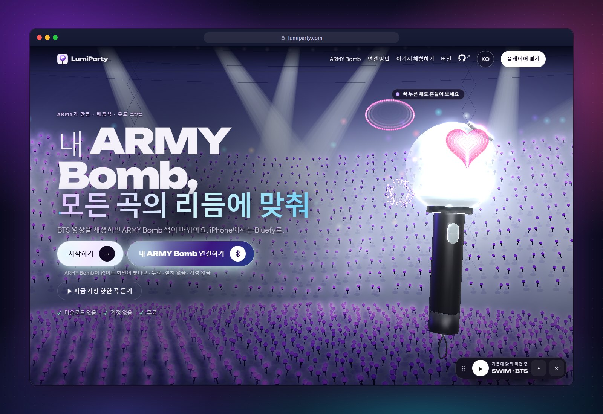
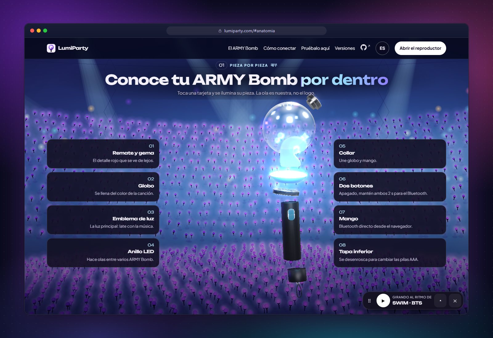
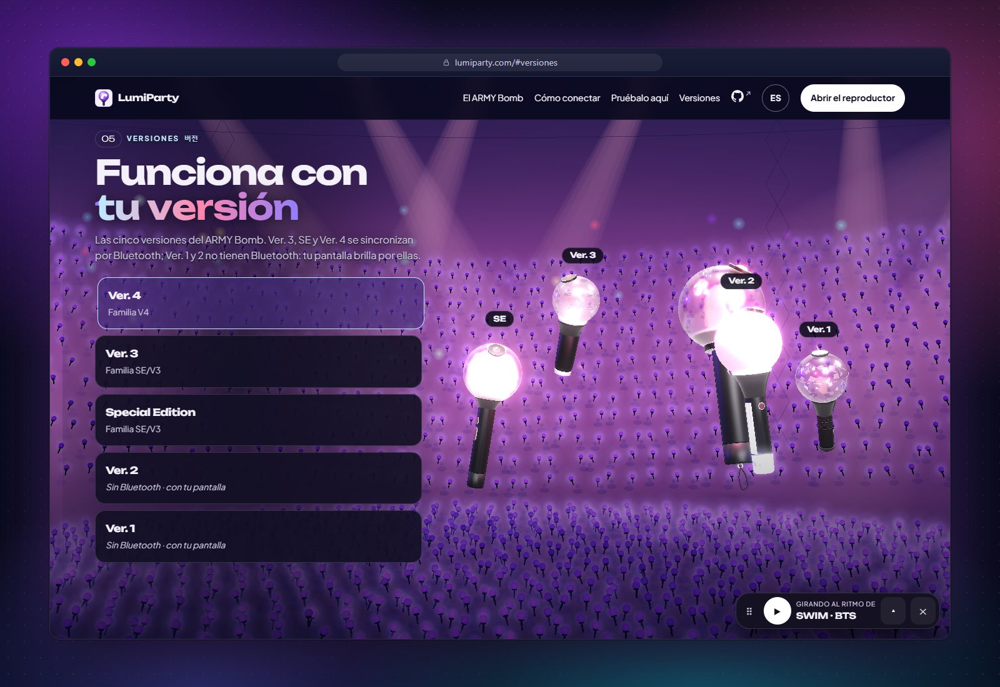
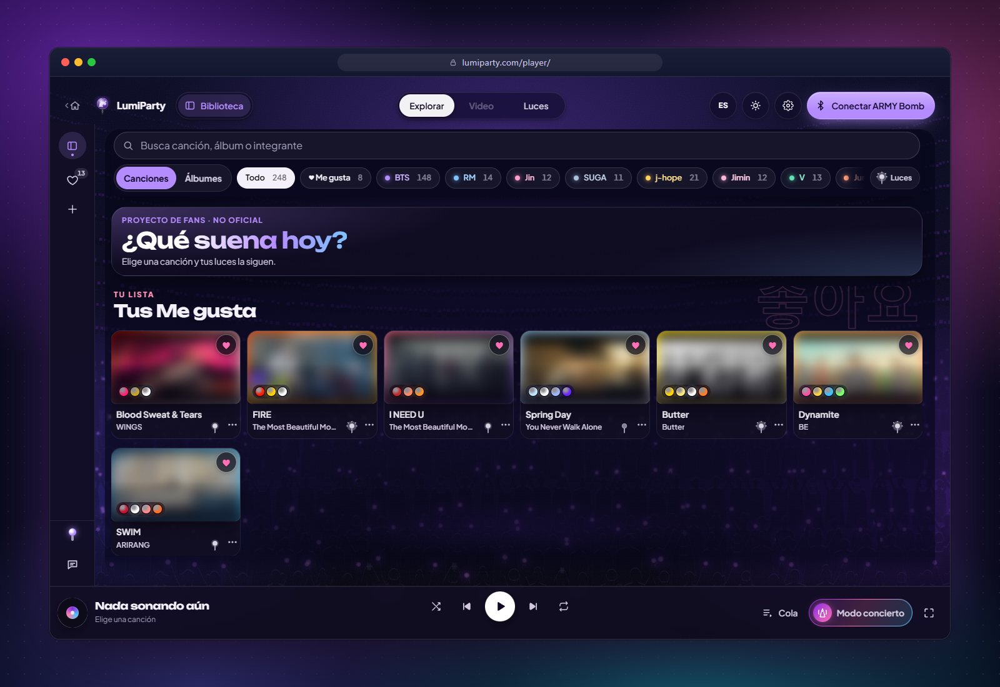
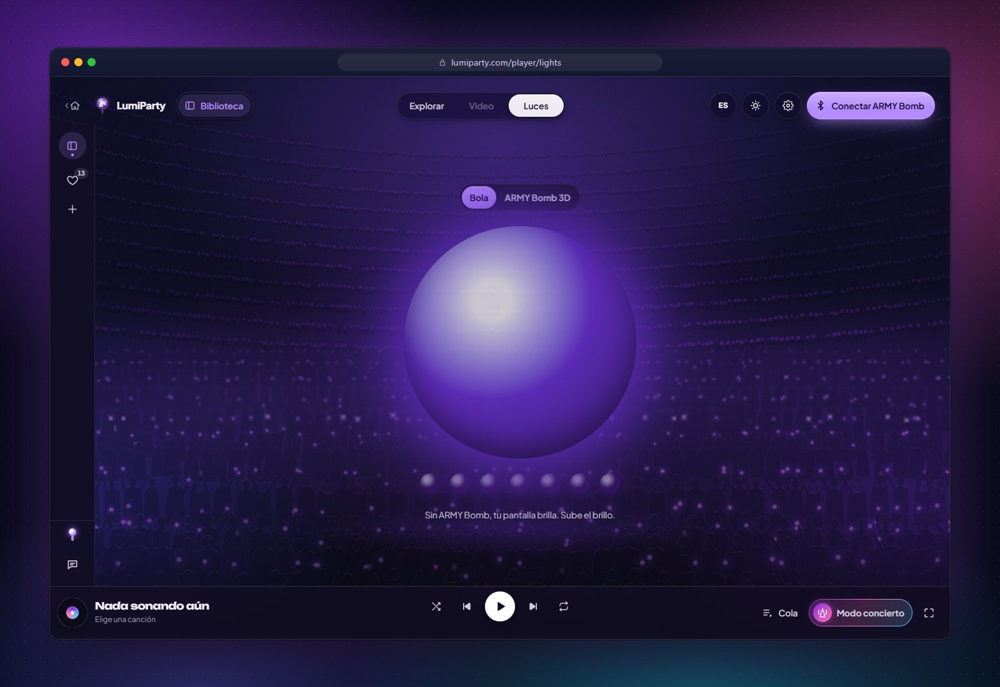
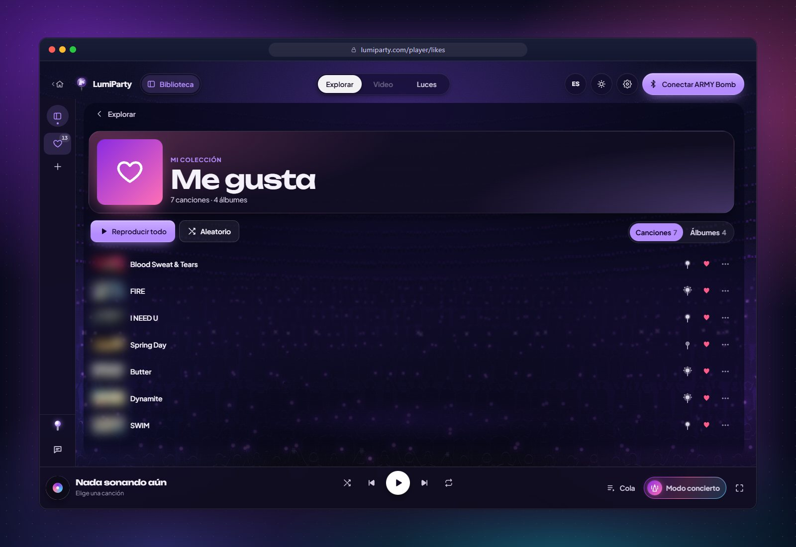
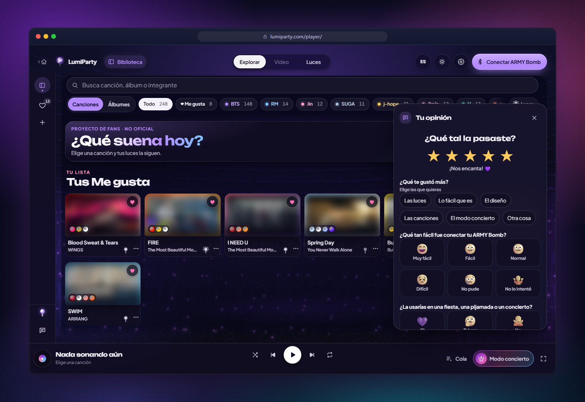
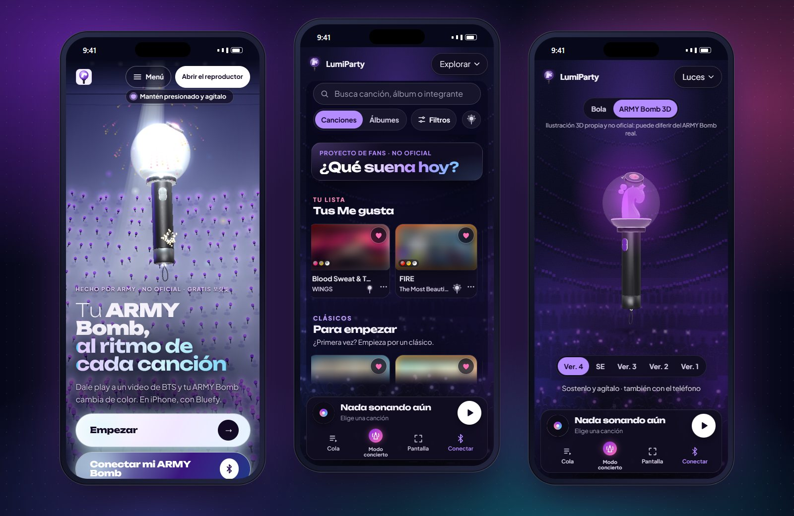
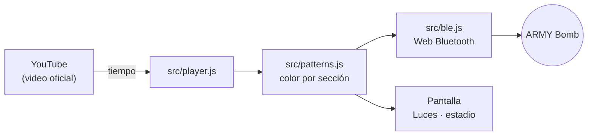

<p align="center">
  <a href="README.md">Español</a> ·
  <a href="README.en.md">English</a> ·
  <a href="README.pt-BR.md">Português (Brasil)</a> ·
  <b>🌐 한국어</b> ·
  <a href="README.id.md">Bahasa Indonesia</a>
</p>

<div align="center">

<a href="https://lumiparty.com/"></a>

# LumiParty

**모든 노래의 리듬에 맞춰 빛나는 나의 아미밤.**

블루투스로 응원봉을 BTS 공식 영상과 싱크해 주는, 무료 오픈소스 팬 웹페이지예요.
설치도, 계정도 필요 없어요.

<a href="https://lumiparty.com/"></a>
<a href="LICENSE"></a>


<br>


<a href="https://github.com/KarlaMedina97/lightstick-bts-concert-sync/stargazers"></a>

</div>

<br>

BTS 영상을 재생하면 인트로, 후렴, 브릿지에 맞춰 **아미밤** 색이 바뀌어요. 마치 공연장에 있는 것처럼요!
아미밤이 지금 없다면 **화면이 대신 빛나요**. 모든 건 브라우저 안에서 이루어져요. 설치할 수 있고
오프라인에서도 열리는 프로그레시브 웹 앱(PWA)이에요.

> [!NOTE]
> **비공식** 팬 프로젝트이며, HYBE, BIGHIT MUSIC, BTS와 아무런 관련이 없어요. 영상은 YouTube 공식 채널에서
> 재생되며, 이 저장소에는 오디오, 영상, 가사가 포함되어 있지 않아요.

<p align="center">
  <a href="https://lumiparty.com/"></a>
</p>

## 📑 목차

- [✨ 기능](#features)
- [📱 호환성](#compatibility)
- [🚀 사용 방법](#how-to-use)
- [🛠️ 개발](#development)
- [🧱 아키텍처](#architecture)
- [🔒 개인정보 보호](#privacy)
- [⚖️ 법적 고지](#legal-notice)
- [🤝 기여하기](#contributing)
- [💜 후원](#support)
- [📄 라이선스](#license)
- [🌐 다른 언어](#languages)

<a id="features"></a>

## ✨ 기능

<table>
  <tr>
    <td width="50%" valign="top">
      
      <h3>🔍 하나하나 살펴보기</h3>
      스크롤하면 분해되는 3D 아미밤(직접 그린 일러스트, 오리지널 물결 엠블럼 사용)이에요.
      카드를 터치하면 해당 부품이 빛나요.
    </td>
    <td width="50%" valign="top">
      
      <h3>🪄 다섯 가지 버전</h3>
      Ver. 4, SE, Ver. 3는 블루투스로 연결돼요. Ver. 2와 Ver. 1은 블루투스가 없어서 화면이 대신 빛나요.
    </td>
  </tr>
  <tr>
    <td width="50%" valign="top">
      
      <h3>🎵 탐색</h3>
      그룹과 멤버별 노래를 앨범 단위로 묶었고, 검색과 필터도 있어요. 노래 한 곡이 끝나면
      다음 곡이 시작돼요.
    </td>
    <td width="50%" valign="top">
      
      <h3>💡 조명</h3>
      순간순간의 색으로 빛나는 거대한 빛 구체(또는 3D 아미밤). 아미밤이 없어도 화면이 응원봉이 돼요.
    </td>
  </tr>
  <tr>
    <td width="50%" valign="top">
      
      <h3>💜 좋아요</h3>
      ♡로 노래와 앨범을 저장하고 순서대로 또는 셔플로 재생해요. 저장은 내 기기에만 돼요.
    </td>
    <td width="50%" valign="top">
      
      <h3>⭐ 의견 남기기</h3>
      먼저 별점을 주고, 점수에 따라 시각적인 선택지로 된 질문 몇 개에 답해요. 익명이고 몇 초면 끝나요.
    </td>
  </tr>
</table>

<p align="center">
  
  <br><sub>휴대폰에서: 홈, 탐색, 그리고 <i>조명</i> 화면의 3D 아미밤.</sub>
</p>

**그리고 또:**

| | |
| --- | --- |
| 🎛️ **콘서트 조명** | 노래마다 섹션, 에너지, 팔레트에 맞춰 브라우저에서 만들어지는 패턴. |
| 🌊 **파도타기** | 아미밤 여러 개를 연결하면 각각 살짝 시차를 두고 빛나요. 공연장 파도타기처럼요. |
| 🏟️ **콘서트 모드** | *공연장에서*: 카메라가 주변 아미밤의 색을 따라 해요. *TV로 볼 때*: 마이크가 방 안의 음악을 따라가요(유료 플랫폼 콘서트용). 아무것도 녹화·녹음되지 않아요. |
| 📣 **응원법** | 노래와 노래 사이에 멤버 이름이 한글과 로마자로 나와요. 건너뛰거나 끌 수 있어요. |
| 🎬 **내 영상** | YouTube 공식 채널 영상을 추가해서 똑같이 싱크할 수 있어요. |
| 🧭 **연결 가이드** | 공연 전 안내 방송처럼 애니메이션과 내레이션이 있는 4단계 가이드. |
| ♿ **모든 아미를 위해** | 안전 모드 기본 켜짐(초당 최대 3회 깜빡임, WCAG 2.3.1), 키보드, 스크린 리더, `prefers-reduced-motion` 지원. |
| 🌐 **다섯 가지 언어** | Español, English, Português (Brasil), 한국어, Bahasa Indonesia. |
| 📲 **설치 가능** | 서비스 워커가 있는 PWA: 오프라인에서도 열려요(영상은 인터넷이 필요해요). |

<a id="compatibility"></a>

## 📱 호환성

| 플랫폼 | 영상과 화면 조명 | 블루투스로 아미밤 연결 |
| --- | :---: | :---: |
| Android: Chrome, Edge | ✅ | ✅ |
| Windows, macOS, ChromeOS, Linux: Chrome, Edge | ✅ | ✅ |
| Brave | ✅ | ⚠️ `brave://flags`에서 Web Bluetooth를 켜야 해요(앱에서 방법을 알려줘요) |
| Mac의 Firefox, Safari | ✅ | ❌ Web Bluetooth 미지원 |
| iPhone / iPad: Safari | ✅ | ❌ Apple이 웹에서 블루투스를 허용하지 않아요 |
| iPhone / iPad: [Bluefy](https://apps.apple.com/app/id1492822055) (무료) | ✅ | ✅ |

| ARMY Bomb 버전 | 작동 방식 |
| --- | --- |
| **Ver. 4** | 블루투스 (V4 계열) |
| **Special Edition**, **Ver. 3** | 블루투스 (SE/V3 계열) |
| **Ver. 2**, **Ver. 1** | 블루투스 없음: 화면이 노래에 맞춰 빛나요 |

> [!TIP]
> Web Bluetooth는 `https://` 또는 `localhost`가 필요해요. 프로토콜은
> [docs/protocolo-ble.md](docs/protocolo-ble.md)에 정리되어 있어요. 아직 모든 하드웨어 모델로 테스트하지는 못했어요.
> 아미밤이 연결되지 않는다면 [이슈를 열어 주세요](https://github.com/KarlaMedina97/lightstick-bts-concert-sync/issues).

<a id="how-to-use"></a>

## 🚀 사용 방법

1. Chrome이나 Edge(iPhone에서는 Bluefy)로 **[lumiparty.com](https://lumiparty.com/)** 사이트에 접속해서 **시작하기**를 눌러요.
2. **탐색**에서 노래를 골라요. 이제 화면이 노래에 맞춰 빛나요.
3. 아미밤이 있나요? **내 아미밤 연결하기**를 누르고 4단계 가이드를 따라 해요. 아미밤이 꺼진 상태에서
   두 버튼을 2초 정도 길게 눌러 블루투스 모드로 바꾼 다음, 목록에서 선택하면 돼요.
4. 언제든 **영상**과 **조명** 화면을 오갈 수 있어요. **설정**에서 밝기, 조명 지연, 스타일을 바꿀 수 있고,
   언어는 언어 버튼에서 바꿔요.
5. TV로 콘서트를 보거나 공연장에 있나요? **콘서트 모드**를 열어 보세요.

앱처럼 쓰고 싶다면 브라우저에서 *설치* 또는 *홈 화면에 추가*를 눌러요.

<a id="development"></a>

## 🛠️ 개발

빌드도 npm 의존성도 없는 정적 사이트예요. 네이티브 ES 모듈을 쓰는 모던 JavaScript이고, three.js와 GSAP는
`vendor/`에 복사되어 있어요. [Node.js](https://nodejs.org) 22 이상만 있으면 돼요.

```bash
git clone https://github.com/KarlaMedina97/lightstick-bts-concert-sync.git
cd lightstick-bts-concert-sync
npm run dev        # http://localhost:5173
```

| 명령어 | 하는 일 |
| --- | --- |
| `npm run dev` | http://localhost:5173 에서 로컬 서버 실행 (휴대폰에서 테스트하려면 `npm run dev:lan`) |
| `npm test` | 단위 테스트 (`node --test`) |
| `npm run csp` | 페이지의 Content-Security-Policy 재생성 |
| `npm run check` | 테스트 + CSP 최신 여부 + 빌드: CI에서 돌리는 것과 동일 |
| `npm run check:ui` | 창 없는 실제 브라우저(390, 1440 px)에서 테스트: 예외, 가로 스크롤, 고정(sticky) 분해도, 아이콘. 스크린샷은 `.ui-check/`에 저장 |
| `npm run check:embeds` | 카탈로그의 모든 영상이 페이지 안에서 재생 가능한지 확인 |
| `npm run check:commits` | `origin/main` 기준으로 커밋 메시지 검사 |
| `npm run build` | 배포할 파일만 모아 `_site/` 생성 |

push 전마다 `check:ui`를 실행하는 훅을 한 번만 켜 두세요:

```bash
git config core.hooksPath .githooks
```

사이트는 `main`에 push할 때마다 `.github/workflows/ci.yml`을 통해 GitHub Pages에 배포돼요. 프로젝트의 전체 규칙
(법률, 보안, 언어, 접근성)은 [CLAUDE.md](CLAUDE.md)에 있어요.

<a id="architecture"></a>

## 🧱 아키텍처

```
index.html · landing.css · src/landing.js    Inicio 3D (three.js + GSAP): ARMY Bomb, anatomía, versiones, estadio
player/index.html · styles.css · src/app.js  Reproductor: Explorar, Video, Luces, Me gusta, Mis videos, paneles
src/ble.js                                   Web Bluetooth: descubrimiento, familias V4 y SE/V3, ritmo de escritura
src/player.js                                Reproductor de YouTube con reloj interpolado
src/patterns.js                              Patrones de luz por secciones y looks por canción
src/catalog.js                               Álbumes, canciones (videos oficiales) y conciertos
src/stick3d.js                               ARMY Bomb 3D de la vista Luces
src/camera.js · src/mic.js                   Modo concierto: cámara y micrófono (todo en el dispositivo)
src/fanchant.js · src/crowd.js               Fanchant entre canciones y público en canvas
src/guide.js · src/tour.js                   Guía de conexión y recorrido de bienvenida
src/favorites.js · src/feedback.js           Me gusta y opiniones
src/i18n.js · src/i18n/                      Español (fuente) + en, pt-BR, ko, id
sw.js · manifest.webmanifest                 PWA: caché sin conexión e instalación
vendor/ · fonts/                             three.js, GSAP y fuentes servidas localmente (sin CDNs)
scripts/ · tests/                            Servidor local, CSP, build, pruebas y check:ui
```



<a id="privacy"></a>

## 🔒 개인정보 보호

- **계정도 자체 서버도 없어요.** 좋아요, 설정, 기록은 내 기기에만 저장되고 *설정*에서 지울 수 있어요.
- **쿠키 없는 Google Analytics 4**: 방문한 페이지와 이름이 고정된 이벤트만 수집하며, IP는 익명화되고 광고 신호는
  사용하지 않아요. *Do Not Track*이나 *Global Privacy Control*이 켜져 있을 때와 localhost에서는 로드되지 않아요.
- **카메라와 마이크**는 기기 안에서 처리돼요. 아무것도 녹화·녹음되거나 전송되지 않아요.
- 개인정보 보호 강화 모드의 YouTube(`youtube-nocookie.com`), 모든 페이지에 Content-Security-Policy 적용, 라이브러리는
  `vendor/`에서 제공해요.

자세한 내용은 [개인정보 처리방침](https://lumiparty.com/privacy/)과 [SECURITY.md](SECURITY.md)에서 확인하세요.

<a id="legal-notice"></a>

## ⚖️ 법적 고지

LumiParty는 **비공식 팬 프로젝트**예요. HYBE, BIGHIT MUSIC, BTS 및 ARMY Bomb 제조사와 제휴하거나 후원 또는 승인을
받지 않았어요. BTS, ARMY Bomb 및 아티스트, 앨범, 노래의 이름은 각 소유자의 상표 또는 재산이며, 음악을 식별하는
목적으로만 사용돼요.

- 이 저장소에는 가사, 오디오, 영상, 공식 로고가 **포함되어 있지 않아요**. 영상은 YouTube 공식 채널에서 YouTube
  플레이어로 재생되며, 이 README 스크린샷의 썸네일은 의도적으로 흐리게 처리했어요.
- 3D 아미밤은 오리지널 물결 모양 엠블럼을 사용한 직접 그린 일러스트예요.
- 블루투스 프로토콜은 상호운용성을 위해 문서화했으며, 구현은 직접 작성했어요.

권리자로서 삭제를 원하는 내용이 있나요? [이슈를 열어 주세요](https://github.com/KarlaMedina97/lightstick-bts-concert-sync/issues).
최대한 빨리 처리할게요.

<a id="contributing"></a>

## 🤝 기여하기

어떤 도움이든 환영해요! 시작하기 전에 [CONTRIBUTING.md](CONTRIBUTING.md)를 읽어 주세요.

- **커밋**은 [Conventional Commits](https://www.conventionalcommits.org/es/) 형식, 스페인어로: `feat(luces): …`, `fix(ble): …`.
- **새 노래**: 공식 채널 영상만, 풍성한 조명과 함께(`tests/looks.test.js`의 품질 검사에서 요구해요).
  [docs/patrones-luces.md](docs/patrones-luces.md)를 참고하세요.
- **화면에 보이는 텍스트**는 스페인어로 쓰고, `src/i18n/`에 번역을 추가해요.
- 풀 리퀘스트를 열기 전에: `npm run check`, 그리고 인터페이스를 수정했다면 `npm run check:ui`.

내 아미밤으로 써 봤나요? 앱 안의 **의견 남기기**에서 어땠는지 알려 주세요.

<a id="support"></a>

## 💜 후원

LumiParty는 무료이고 앞으로도 무료예요. 마음에 든다면 이렇게 응원해 주세요:

- 저장소에 ⭐ 남기기,
- [GitHub Sponsors](https://github.com/sponsors/KarlaMedina97)로 개발 후원하기,
- 다른 아미들과 공유하기.

<a id="license"></a>

## 📄 라이선스

[MIT](LICENSE) © Karla Medina, 프로젝트 자체 코드에 한해 적용돼요.

**`vendor/gsap/`는 적용 대상이 아니에요**: GSAP 3.13.0은 GreenSock의 Standard "무료(no charge)" 라이선스로 사용해요
([`vendor/gsap/LICENSE.txt`](vendor/gsap/LICENSE.txt) 및 https://gsap.com/standard-license 참고). three.js는
자체 MIT 라이선스([`vendor/README.md`](vendor/README.md))를 유지하고, Unbounded와 Plus Jakarta Sans 폰트는 SIL Open Font
License를 따라요([`fonts/`](fonts/) 참고).

<a id="languages"></a>

## 🌐 다른 언어

이 README는 앱과 같은 언어인 [Español](README.md) · [English](README.en.md) · [Português (Brasil)](README.pt-BR.md) ·
[Bahasa Indonesia](README.id.md)로도 볼 수 있어요.

<div align="center">
<br>
<sub>ARMY가 💜을 담아 만들었어요 · <a href="https://lumiparty.com/">lumiparty.com</a></sub>
</div>
