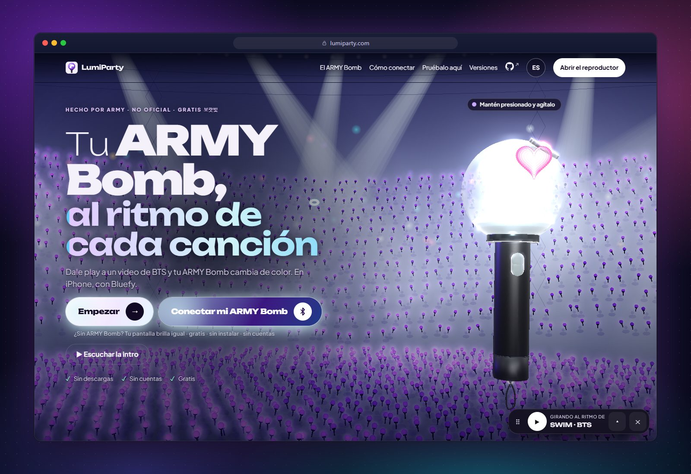
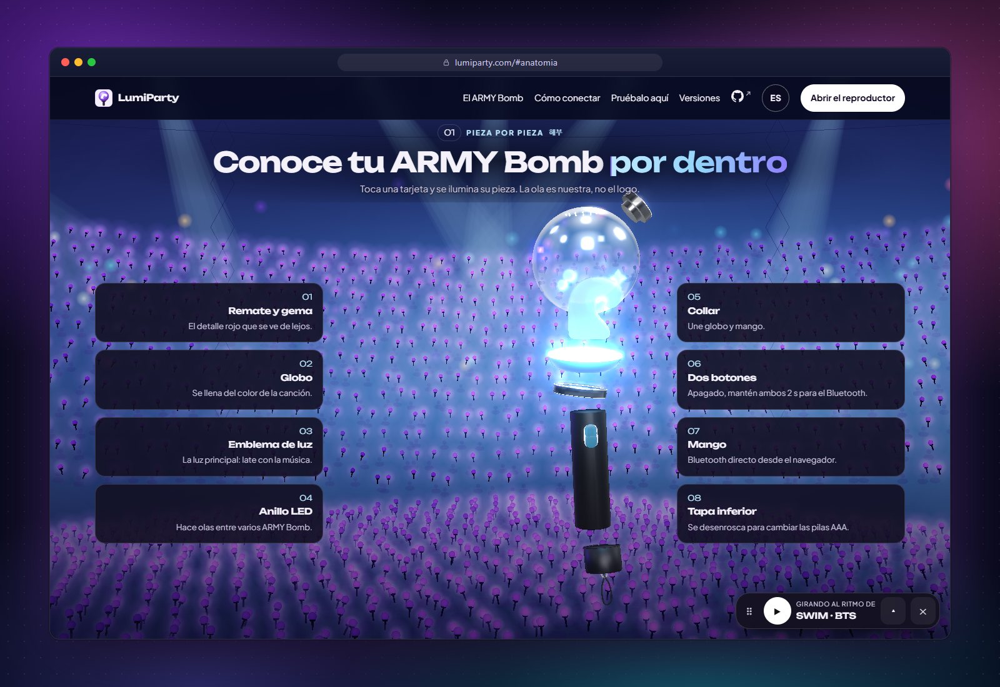
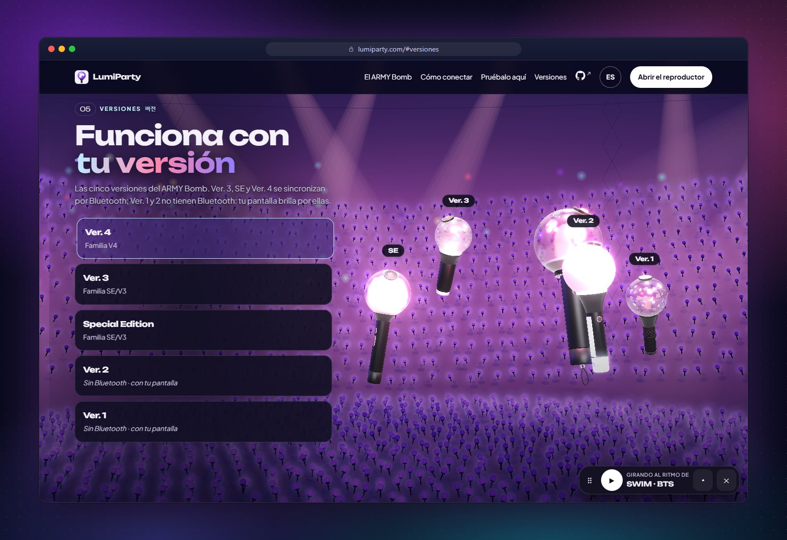
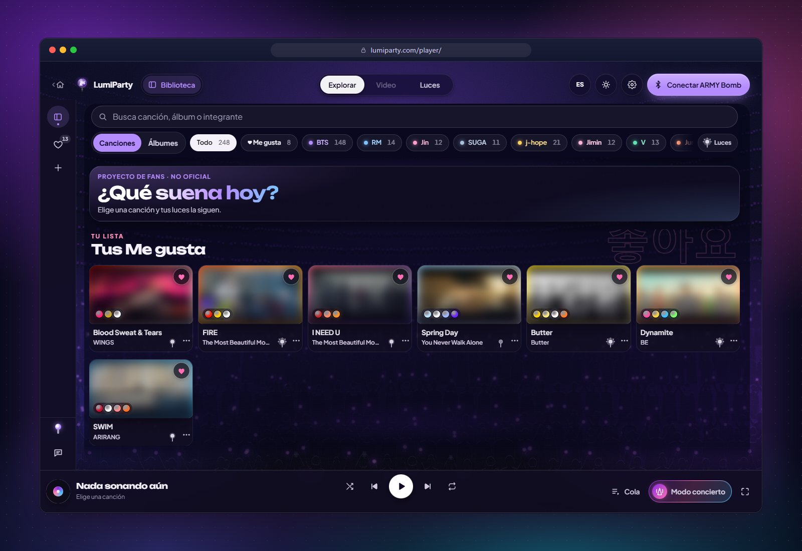
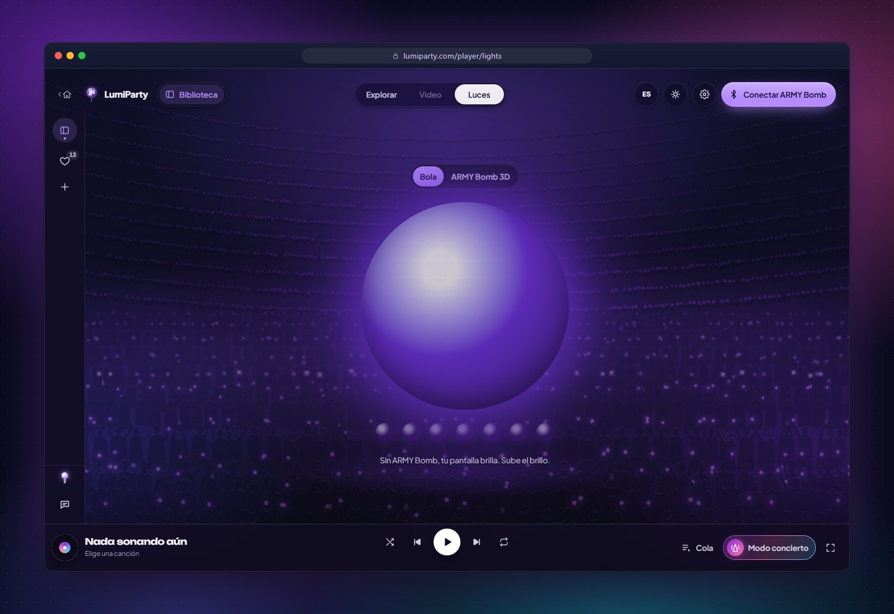
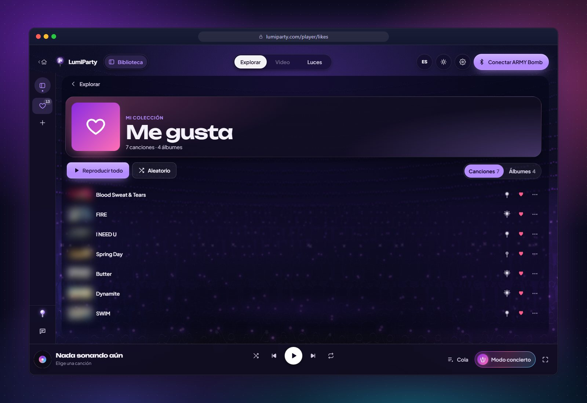
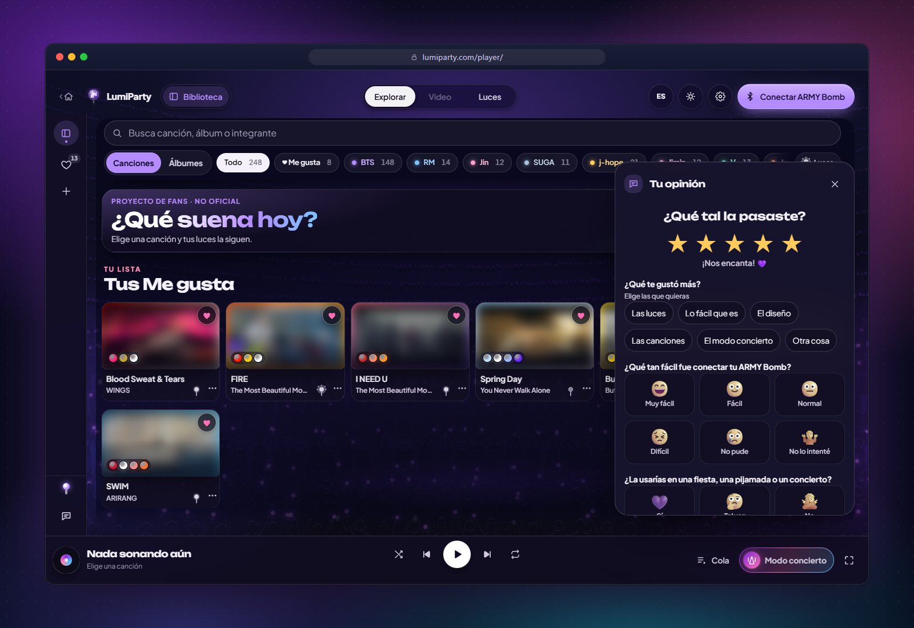
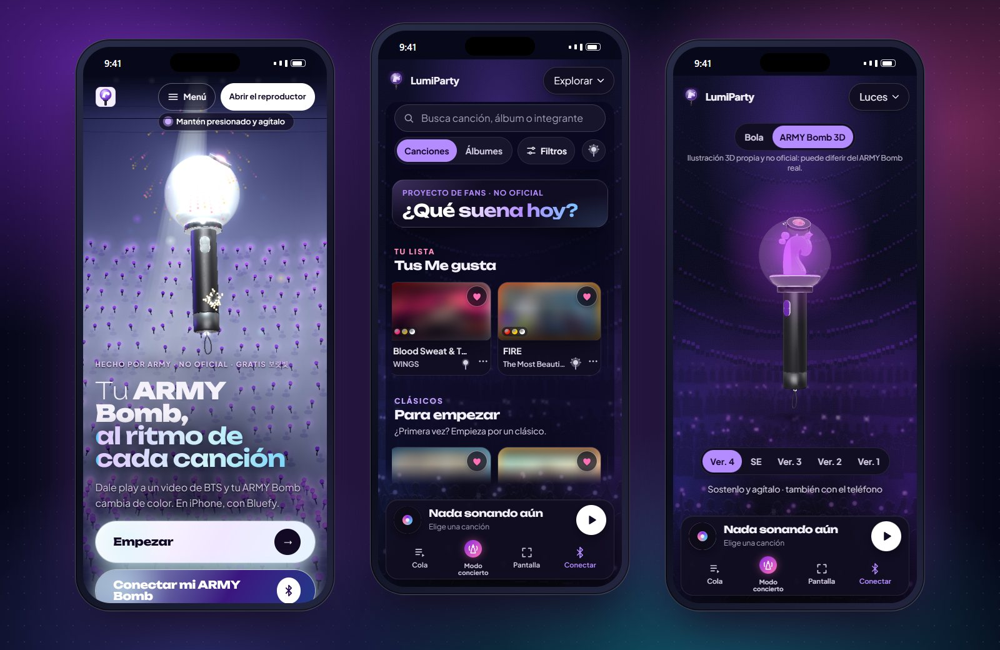
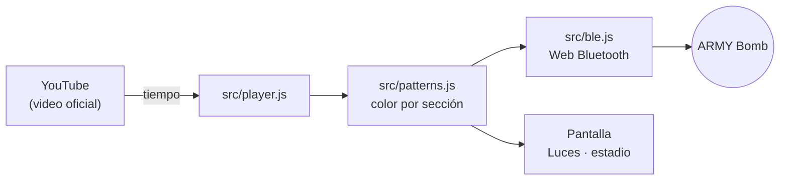

<p align="center">
  <b>🌐 Español</b> ·
  <a href="README.en.md">English</a> ·
  <a href="README.pt-BR.md">Português (Brasil)</a> ·
  <a href="README.ko.md">한국어</a> ·
  <a href="README.id.md">Bahasa Indonesia</a>
</p>

<div align="center">

<a href="https://lumiparty.com/"></a>

# LumiParty

**Tu ARMY Bomb, al ritmo de cada canción.**

Página web de fans, gratuita y de código abierto, que sincroniza tu lightstick por Bluetooth con los videos oficiales de BTS.
Sin instalar nada, sin cuentas.

<a href="https://lumiparty.com/"></a>
<a href="LICENSE"></a>


<br>


<a href="https://github.com/KarlaMedina97/lightstick-bts-concert-sync/stargazers"></a>

</div>

<br>

Dale play a un video de BTS y tu **ARMY Bomb** cambia de color con la intro, el coro y el puente, como en el
estadio. Si no tienes uno a mano, **tu pantalla brilla por él**. Todo pasa en el navegador: es una app web
progresiva (PWA) que se puede instalar y abre sin conexión.

> [!NOTE]
> Proyecto de fans **no oficial**, sin afiliación con HYBE, BIGHIT MUSIC ni BTS. Los videos se reproducen desde
> canales oficiales de YouTube; este repositorio no contiene audio, video ni letras.

<p align="center">
  <a href="https://lumiparty.com/"></a>
</p>

## 📑 Contenido

- [✨ Funciones](#funciones)
- [📱 Compatibilidad](#compatibilidad)
- [🚀 Cómo usar](#como-usar)
- [🛠️ Desarrollo](#desarrollo)
- [🧱 Arquitectura](#arquitectura)
- [🔒 Privacidad](#privacidad)
- [⚖️ Aviso legal](#aviso-legal)
- [🤝 Contribuir](#contribuir)
- [💜 Apoyo](#apoyo)
- [📄 Licencia](#licencia)
- [🌐 Otros idiomas](#idiomas)

<a id="funciones"></a>

## ✨ Funciones

<table>
  <tr>
    <td width="50%" valign="top">
      
      <h3>🔍 Pieza por pieza</h3>
      Un ARMY Bomb 3D (ilustración propia, con un emblema de ola original) que se desarma al hacer scroll.
      Toca una tarjeta y se ilumina su pieza.
    </td>
    <td width="50%" valign="top">
      
      <h3>🪄 Las cinco versiones</h3>
      Ver. 4, SE y Ver. 3 se conectan por Bluetooth. Ver. 2 y Ver. 1 no tienen Bluetooth: tu pantalla brilla por ellas.
    </td>
  </tr>
  <tr>
    <td width="50%" valign="top">
      
      <h3>🎵 Explorar</h3>
      Canciones agrupadas por álbum, del grupo y de cada integrante, con búsqueda y filtros. Al terminar una
      canción empieza la siguiente.
    </td>
    <td width="50%" valign="top">
      
      <h3>💡 Luces</h3>
      Una bola de luz gigante (o el ARMY Bomb 3D) con el color de cada momento. Sin ARMY Bomb, tu pantalla es tu lightstick.
    </td>
  </tr>
  <tr>
    <td width="50%" valign="top">
      
      <h3>💜 Me gusta</h3>
      Guarda canciones y álbumes con ♡ y reprodúcelos en orden o en aleatorio. Se guarda solo en tu dispositivo.
    </td>
    <td width="50%" valign="top">
      
      <h3>⭐ Tu opinión</h3>
      Primero estrellas; luego, según la nota, unas preguntas con opciones visuales. Anónimo y en segundos.
    </td>
  </tr>
</table>

<p align="center">
  
  <br><sub>En el teléfono: inicio, Explorar y el ARMY Bomb 3D en <i>Luces</i>.</sub>
</p>

**Y además:**

| | |
| --- | --- |
| 🎛️ **Luces de concierto** | Patrones generados en tu navegador según la sección, la energía y la paleta de cada canción. |
| 🌊 **Olas** | Con varios ARMY Bomb conectados, cada uno lleva un pequeño desfase, como la ola del estadio. |
| 🏟️ **Modo concierto** | *En el estadio*: la cámara copia el color de los ARMY Bomb de alrededor. *En la TV*: el micrófono sigue la música de la habitación (para conciertos en plataformas de pago). Nada se graba. |
| 📣 **Fanchant** | Entre canciones aparecen los nombres de los integrantes, en hangul y romanizados. Se puede saltar o apagar. |
| 🎬 **Mis videos** | Agrega videos de canales oficiales de YouTube y sincronízalos igual. |
| 🧭 **Guía de conexión** | Cuatro pasos animados y narrados, como los anuncios antes de un concierto. |
| ♿ **Para cada ARMY** | Modo seguro activado (máx. 3 destellos por segundo, WCAG 2.3.1), teclado, lector de pantalla y `prefers-reduced-motion`. |
| 🌐 **Cinco idiomas** | Español, English, Português (Brasil), 한국어 y Bahasa Indonesia. |
| 📲 **Instalable** | PWA con service worker: abre sin conexión (los videos sí necesitan internet). |

<a id="compatibilidad"></a>

## 📱 Compatibilidad

| Plataforma | Videos y luces en pantalla | ARMY Bomb por Bluetooth |
| --- | :---: | :---: |
| Android: Chrome, Edge | ✅ | ✅ |
| Windows, macOS, ChromeOS, Linux: Chrome, Edge | ✅ | ✅ |
| Brave | ✅ | ⚠️ Hay que activar Web Bluetooth en `brave://flags` (la app explica cómo) |
| Firefox, Safari en Mac | ✅ | ❌ No tienen Web Bluetooth |
| iPhone / iPad: Safari | ✅ | ❌ Apple no permite Bluetooth en la web |
| iPhone / iPad: [Bluefy](https://apps.apple.com/app/id1492822055) (gratis) | ✅ | ✅ |

| Versión del ARMY Bomb | Cómo funciona |
| --- | --- |
| **Ver. 4** | Bluetooth (familia V4) |
| **Special Edition** y **Ver. 3** | Bluetooth (familia SE/V3) |
| **Ver. 2** y **Ver. 1** | Sin Bluetooth: tu pantalla brilla con la canción |

> [!TIP]
> Web Bluetooth necesita `https://` o `localhost`. El protocolo está documentado en
> [docs/protocolo-ble.md](docs/protocolo-ble.md). Aún no hay pruebas con cada modelo de hardware: si tu
> ARMY Bomb no conecta, [abre un issue](https://github.com/KarlaMedina97/lightstick-bts-concert-sync/issues).

<a id="como-usar"></a>

## 🚀 Cómo usar

1. Abre **[lumiparty.com](https://lumiparty.com/)** en Chrome o Edge (en iPhone, en Bluefy) y toca **Empezar**.
2. Elige una canción en **Explorar**. Tu pantalla ya brilla con ella.
3. ¿Tienes ARMY Bomb? Toca **Conectar mi ARMY Bomb** y sigue la guía de 4 pasos: con el ARMY Bomb apagado,
   mantén presionados sus dos botones unos 2 segundos para que entre en modo Bluetooth y elígelo en la lista.
4. Cambia entre **Video** y **Luces** cuando quieras. En **Ajustes** puedes cambiar el brillo, el retraso de las
   luces y el estilo; el idioma, desde el botón de idioma.
5. ¿Concierto en la TV o en el estadio? Abre **Modo concierto**.

Para tenerla como app, usa *Instalar* o *Agregar a la pantalla de inicio* en tu navegador.

<a id="desarrollo"></a>

## 🛠️ Desarrollo

Sitio estático sin build ni dependencias de npm: JavaScript moderno con módulos ES nativos, three.js y GSAP
copiados en `vendor/`. Solo necesitas [Node.js](https://nodejs.org) 22 o superior.

```bash
git clone https://github.com/KarlaMedina97/lightstick-bts-concert-sync.git
cd lightstick-bts-concert-sync
npm run dev        # http://localhost:5173
```

| Comando | Qué hace |
| --- | --- |
| `npm run dev` | Servidor local en http://localhost:5173 (`npm run dev:lan` para probar en el teléfono) |
| `npm test` | Pruebas unitarias (`node --test`) |
| `npm run csp` | Regenera la Content-Security-Policy de las páginas |
| `npm run check` | Pruebas + CSP al día + build: lo mismo que corre CI |
| `npm run check:ui` | Prueba en un navegador real sin ventana (390 y 1440 px): excepciones, scroll horizontal, anatomía pegajosa, íconos. Deja capturas en `.ui-check/` |
| `npm run check:embeds` | Comprueba que cada video del catálogo se pueda ver dentro de la página |
| `npm run check:commits` | Verifica los mensajes de commit contra `origin/main` |
| `npm run build` | Arma `_site/` con solo lo que se publica |

Activa una vez el gancho que corre `check:ui` antes de cada push:

```bash
git config core.hooksPath .githooks
```

El sitio se publica en GitHub Pages desde `.github/workflows/ci.yml` en cada push a `main`. Las reglas completas
del proyecto (legales, seguridad, idioma, accesibilidad) están en [CLAUDE.md](CLAUDE.md).

<a id="arquitectura"></a>

## 🧱 Arquitectura

```
index.html · landing.css · src/landing.js    Inicio 3D (three.js + GSAP): ARMY Bomb, anatomía, versiones, estadio
player/index.html · styles.css · src/app.js  Reproductor: Explorar, Video, Luces, Me gusta, Mis videos, paneles
src/ble.js                                   Web Bluetooth: descubrimiento, familias V4 y SE/V3, ritmo de escritura
src/player.js                                Reproductor de YouTube con reloj interpolado
src/patterns.js                              Patrones de luz por secciones y looks por canción
src/catalog.js                               Álbumes, canciones (videos oficiales) y conciertos
src/stick3d.js                               ARMY Bomb 3D de la vista Luces
src/camera.js · src/mic.js                   Modo concierto: cámara y micrófono (todo en el dispositivo)
src/fanchant.js · src/crowd.js               Fanchant entre canciones y público en canvas
src/guide.js · src/tour.js                   Guía de conexión y recorrido de bienvenida
src/favorites.js · src/feedback.js           Me gusta y opiniones
src/i18n.js · src/i18n/                      Español (fuente) + en, pt-BR, ko, id
sw.js · manifest.webmanifest                 PWA: caché sin conexión e instalación
vendor/ · fonts/                             three.js, GSAP y fuentes servidas localmente (sin CDNs)
scripts/ · tests/                            Servidor local, CSP, build, pruebas y check:ui
```



<a id="privacidad"></a>

## 🔒 Privacidad

- **Sin cuentas ni servidor propio.** Me gusta, ajustes e historial se guardan solo en tu dispositivo y se pueden borrar desde *Ajustes*.
- **Google Analytics 4 sin cookies**: solo páginas visitadas y eventos con nombres fijos, con IP anonimizada y sin señales
  de anuncios. No se carga con *Do Not Track* ni *Global Privacy Control*, ni en localhost.
- **Cámara y micrófono** se procesan en el dispositivo: nada se graba ni se envía.
- YouTube en modo de privacidad mejorada (`youtube-nocookie.com`), Content-Security-Policy en cada página y librerías
  servidas desde `vendor/`.

Detalles en la [política de privacidad](https://lumiparty.com/privacy/) y en [SECURITY.md](SECURITY.md).

<a id="aviso-legal"></a>

## ⚖️ Aviso legal

LumiParty es un **proyecto de fans no oficial**. No está afiliado, patrocinado ni aprobado por HYBE, BIGHIT MUSIC,
BTS ni los fabricantes del ARMY Bomb. BTS, ARMY Bomb y los nombres de artistas, álbumes y canciones son marcas o
propiedad de sus respectivos dueños y se usan solo para identificar la música.

- El repositorio **no contiene** letras, audio, video ni logos oficiales. Los videos se ven desde canales oficiales de
  YouTube con su reproductor; las miniaturas de las capturas de este README están difuminadas a propósito.
- El ARMY Bomb 3D es una ilustración propia con un emblema original en forma de ola.
- El protocolo Bluetooth se documentó para interoperabilidad; la implementación es propia.

¿Eres titular de derechos y quieres que se retire algo? [Abre un issue](https://github.com/KarlaMedina97/lightstick-bts-concert-sync/issues)
y lo atendemos lo antes posible.

<a id="contribuir"></a>

## 🤝 Contribuir

¡Toda ayuda es bienvenida! Lee [CONTRIBUTING.md](CONTRIBUTING.md) antes de empezar.

- **Commits** con [Conventional Commits](https://www.conventionalcommits.org/es/) en español: `feat(luces): …`, `fix(ble): …`.
- **Canciones nuevas**: solo videos de canales oficiales, con luces ricas (el control de calidad de `tests/looks.test.js`
  lo exige). Ver [docs/patrones-luces.md](docs/patrones-luces.md).
- **Textos visibles** en español, con su traducción en `src/i18n/`.
- Antes de abrir el pull request: `npm run check` y, si tocas la interfaz, `npm run check:ui`.

¿Probaste con tu ARMY Bomb? Cuéntanos cómo te fue desde **Tu opinión** dentro de la app.

<a id="apoyo"></a>

## 💜 Apoyo

LumiParty es gratis y lo seguirá siendo. Si te gusta, puedes:

- dejar una ⭐ en el repositorio,
- apoyar el desarrollo con [GitHub Sponsors](https://github.com/sponsors/KarlaMedina97),
- compartirla con otras ARMY.

<a id="licencia"></a>

## 📄 Licencia

[MIT](LICENSE) © Karla Medina, para el código propio del proyecto.

**No cubre `vendor/gsap/`**: GSAP 3.13.0 se usa con la licencia Standard «sin costo» de GreenSock
(ver [`vendor/gsap/LICENSE.txt`](vendor/gsap/LICENSE.txt) y https://gsap.com/standard-license). three.js mantiene su
licencia MIT ([`vendor/README.md`](vendor/README.md)) y las fuentes Unbounded y Plus Jakarta Sans, la SIL Open Font
License (ver [`fonts/`](fonts/)).

<a id="idiomas"></a>

## 🌐 Otros idiomas

Este README también está en [English](README.en.md) · [Português (Brasil)](README.pt-BR.md) · [한국어](README.ko.md) ·
[Bahasa Indonesia](README.id.md), los mismos idiomas de la app.

<div align="center">
<br>
<sub>Hecho con 💜 por ARMY · <a href="https://lumiparty.com/">lumiparty.com</a></sub>
</div>
