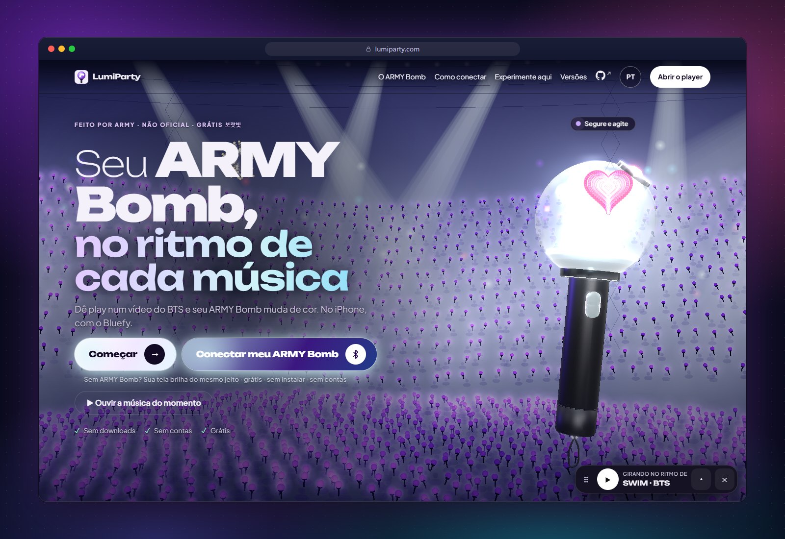
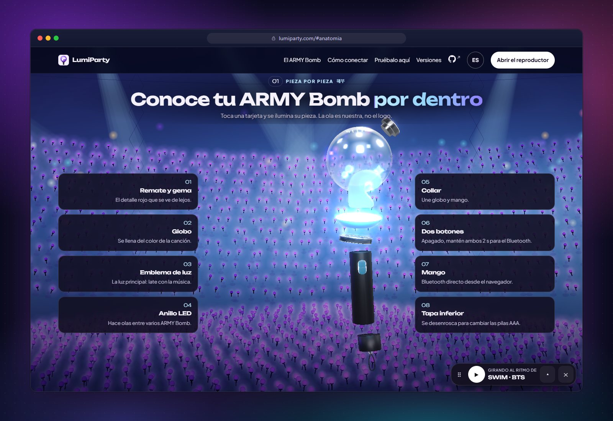
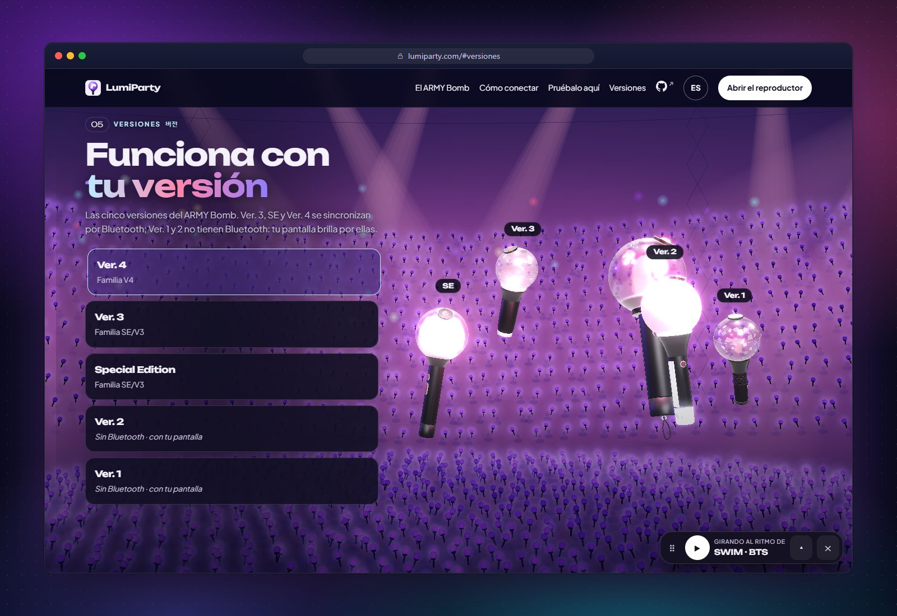
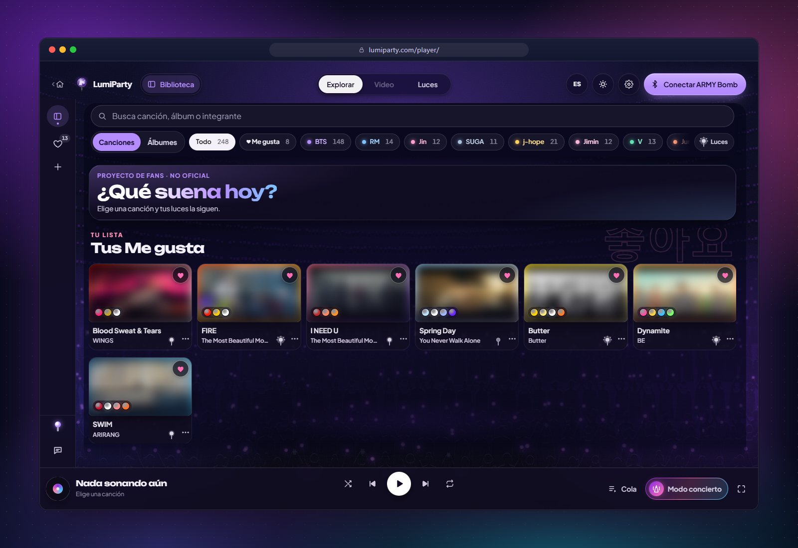
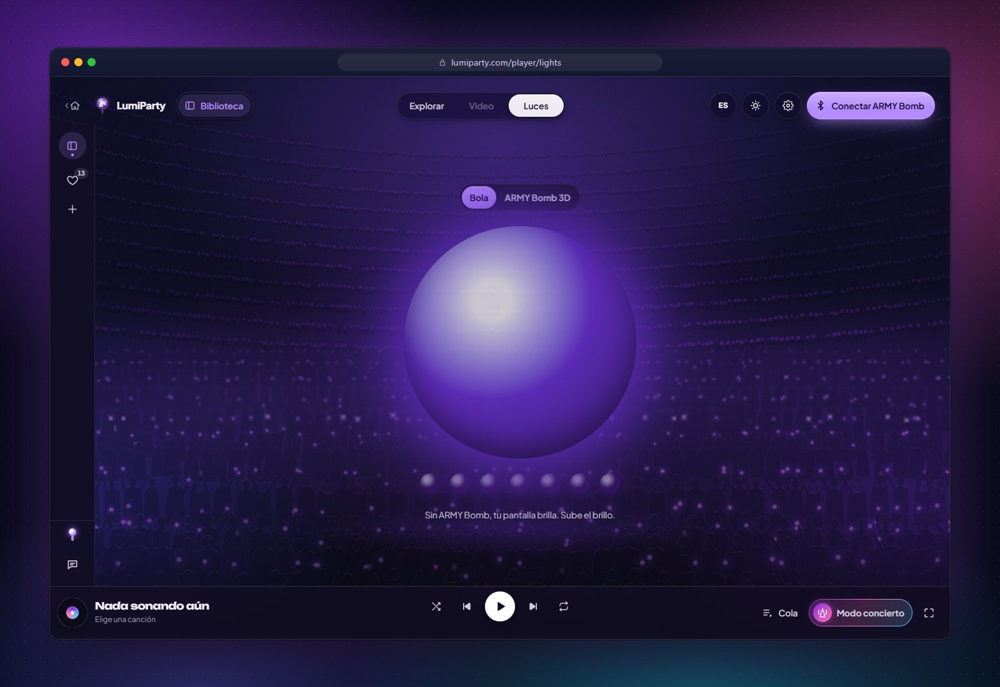
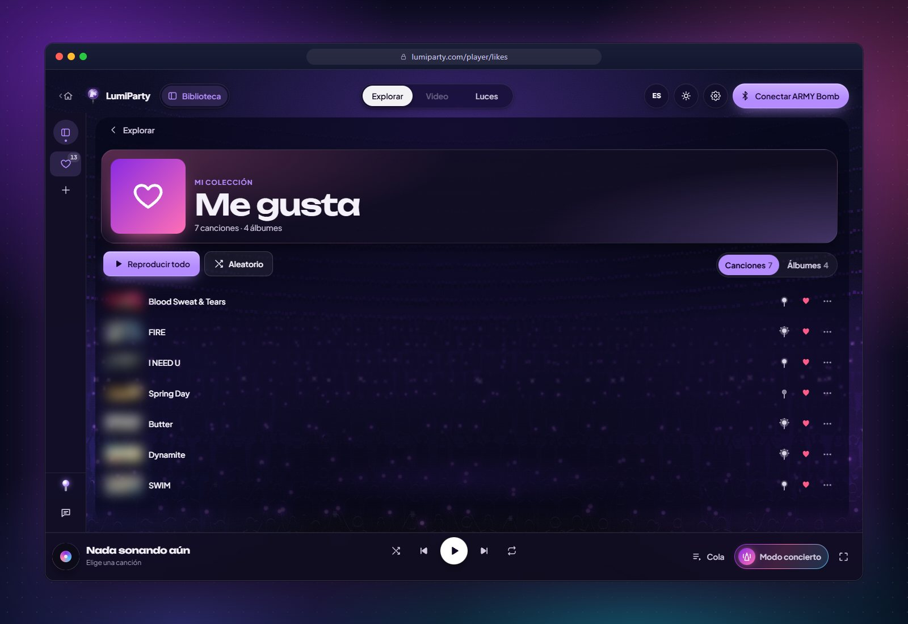
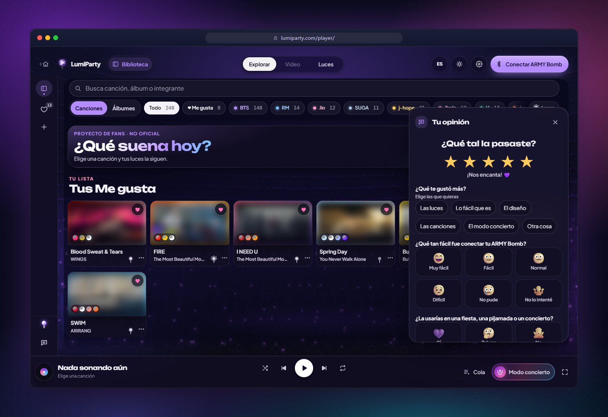
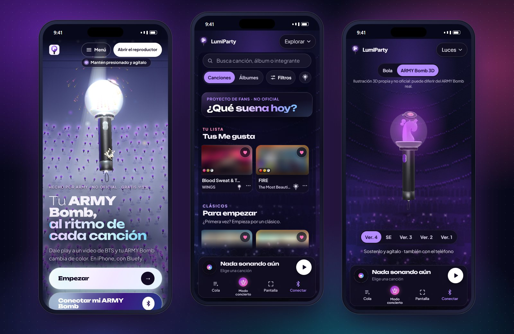
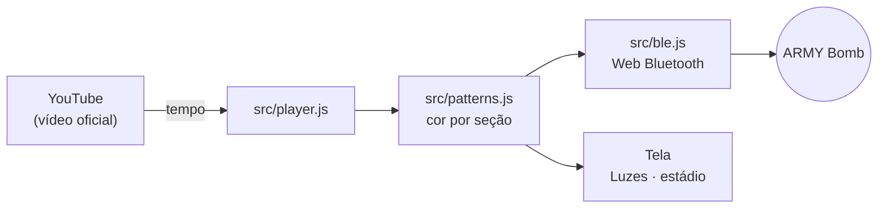

<p align="center">
  <a href="README.md">Español</a> ·
  <a href="README.en.md">English</a> ·
  <b>🌐 Português (Brasil)</b> ·
  <a href="README.ko.md">한국어</a> ·
  <a href="README.id.md">Bahasa Indonesia</a>
</p>

<div align="center">

<a href="https://lumiparty.com/"></a>

# LumiParty

**Seu ARMY Bomb, no ritmo de cada música.**

Site de fãs, gratuito e de código aberto, que sincroniza seu lightstick por Bluetooth com os vídeos oficiais do BTS.
Sem instalar nada, sem contas.

<a href="https://lumiparty.com/"></a>
<a href="LICENSE"></a>


<br>


<a href="https://github.com/KarlaMedina97/lightstick-bts-concert-sync/stargazers"></a>

</div>

<br>

Dê play em um vídeo do BTS e seu **ARMY Bomb** muda de cor com a intro, o refrão e a ponte, como no
estádio. Se você não tiver um por perto, **sua tela brilha por ele**. Tudo acontece no navegador: é um app web
progressivo (PWA) que pode ser instalado e abre sem conexão.

> [!NOTE]
> Projeto de fãs **não oficial**, sem afiliação com a HYBE, a BIGHIT MUSIC ou o BTS. Os vídeos são reproduzidos a partir
> de canais oficiais do YouTube; este repositório não contém áudio, vídeo nem letras.

<p align="center">
  <a href="https://lumiparty.com/"></a>
</p>

## 📑 Conteúdo

- [✨ Funções](#funcoes)
- [📱 Compatibilidade](#compatibilidade)
- [🚀 Como usar](#como-usar)
- [🛠️ Desenvolvimento](#desenvolvimento)
- [🧱 Arquitetura](#arquitetura)
- [🔒 Privacidade](#privacidade)
- [⚖️ Aviso legal](#aviso-legal)
- [🤝 Contribuir](#contribuir)
- [💜 Apoio](#apoio)
- [📄 Licença](#licenca)
- [🌐 Outros idiomas](#idiomas)

<a id="funcoes"></a>

## ✨ Funções

<table>
  <tr>
    <td width="50%" valign="top">
      
      <h3>🔍 Peça por peça</h3>
      Um ARMY Bomb 3D (ilustração própria, com um emblema de onda original) que se desmonta conforme você rola a página.
      Toque em um cartão e a peça dele se ilumina.
    </td>
    <td width="50%" valign="top">
      
      <h3>🪄 As cinco versões</h3>
      Ver. 4, SE e Ver. 3 se conectam por Bluetooth. Ver. 2 e Ver. 1 não têm Bluetooth: sua tela brilha por elas.
    </td>
  </tr>
  <tr>
    <td width="50%" valign="top">
      
      <h3>🎵 Explorar</h3>
      Músicas agrupadas por álbum, do grupo e de cada integrante, com busca e filtros. Quando uma
      música termina, a próxima começa.
    </td>
    <td width="50%" valign="top">
      
      <h3>💡 Luzes</h3>
      Uma bola de luz gigante (ou o ARMY Bomb 3D) com a cor de cada momento. Sem ARMY Bomb, sua tela é o seu lightstick.
    </td>
  </tr>
  <tr>
    <td width="50%" valign="top">
      
      <h3>💜 Curtidas</h3>
      Salve músicas e álbuns com ♡ e ouça em ordem ou no aleatório. Fica salvo só no seu dispositivo.
    </td>
    <td width="50%" valign="top">
      
      <h3>⭐ Sua opinião</h3>
      Primeiro as estrelas; depois, conforme a nota, algumas perguntas com opções visuais. Anônimo e em segundos.
    </td>
  </tr>
</table>

<p align="center">
  
  <br><sub>No celular: início, Explorar e o ARMY Bomb 3D em <i>Luzes</i>.</sub>
</p>

**E mais:**

| | |
| --- | --- |
| 🎛️ **Luzes de show** | Padrões gerados no seu navegador de acordo com a seção, a energia e a paleta de cada música. |
| 🌊 **Ondas** | Com vários ARMY Bombs conectados, cada um fica com um pequeno atraso, como a ola do estádio. |
| 🏟️ **Modo show** | *No estádio*: a câmera copia a cor dos ARMY Bombs ao redor. *Na TV*: o microfone acompanha a música do ambiente (para shows em plataformas pagas). Nada é gravado. |
| 📣 **Fanchant** | Entre as músicas aparecem os nomes dos integrantes, em hangul e romanizados. Dá para pular ou desativar. |
| 🎬 **Meus vídeos** | Adicione vídeos de canais oficiais do YouTube e sincronize do mesmo jeito. |
| 🧭 **Guia de conexão** | Quatro passos animados e narrados, como os avisos antes de um show. |
| ♿ **Para cada ARMY** | Modo seguro ativado (máx. 3 flashes por segundo, WCAG 2.3.1), teclado, leitor de tela e `prefers-reduced-motion`. |
| 🌐 **Cinco idiomas** | Español, English, Português (Brasil), 한국어 e Bahasa Indonesia. |
| 📲 **Instalável** | PWA com service worker: abre sem conexão (os vídeos precisam de internet). |

<a id="compatibilidade"></a>

## 📱 Compatibilidade

| Plataforma | Vídeos e luzes na tela | ARMY Bomb por Bluetooth |
| --- | :---: | :---: |
| Android: Chrome, Edge | ✅ | ✅ |
| Windows, macOS, ChromeOS, Linux: Chrome, Edge | ✅ | ✅ |
| Brave | ✅ | ⚠️ É preciso ativar o Web Bluetooth em `brave://flags` (o app explica como) |
| Firefox, Safari no Mac | ✅ | ❌ Não têm Web Bluetooth |
| iPhone / iPad: Safari | ✅ | ❌ A Apple não permite Bluetooth na web |
| iPhone / iPad: [Bluefy](https://apps.apple.com/app/id1492822055) (grátis) | ✅ | ✅ |

| Versão do ARMY Bomb | Como funciona |
| --- | --- |
| **Ver. 4** | Bluetooth (família V4) |
| **Special Edition** e **Ver. 3** | Bluetooth (família SE/V3) |
| **Ver. 2** e **Ver. 1** | Sem Bluetooth: sua tela brilha com a música |

> [!TIP]
> O Web Bluetooth precisa de `https://` ou `localhost`. O protocolo está documentado em
> [docs/protocolo-ble.md](docs/protocolo-ble.md). Ainda não houve testes com cada modelo de hardware: se o seu
> ARMY Bomb não conectar, [abra uma issue](https://github.com/KarlaMedina97/lightstick-bts-concert-sync/issues).

<a id="como-usar"></a>

## 🚀 Como usar

1. Abra **[lumiparty.com](https://lumiparty.com/)** no Chrome ou no Edge (no iPhone, no Bluefy) e toque em **Começar**.
2. Escolha uma música em **Explorar**. Sua tela já brilha com ela.
3. Tem ARMY Bomb? Toque em **Conectar meu ARMY Bomb** e siga o guia de 4 passos: com o ARMY Bomb desligado,
   mantenha os dois botões pressionados por uns 2 segundos para ele entrar no modo Bluetooth e escolha-o na lista.
4. Alterne entre **Vídeo** e **Luzes** quando quiser. Em **Configurações** você pode mudar o brilho, o atraso das
   luzes e o estilo; o idioma, pelo botão de idioma.
5. Show na TV ou no estádio? Abra o **Modo show**.

Para ter como app, use *Instalar* ou *Adicionar à tela inicial* no seu navegador.

<a id="desenvolvimento"></a>

## 🛠️ Desenvolvimento

Site estático sem build nem dependências do npm: JavaScript moderno com módulos ES nativos, three.js e GSAP
copiados em `vendor/`. Você só precisa do [Node.js](https://nodejs.org) 22 ou superior.

```bash
git clone https://github.com/KarlaMedina97/lightstick-bts-concert-sync.git
cd lightstick-bts-concert-sync
npm run dev        # http://localhost:5173
```

| Comando | O que faz |
| --- | --- |
| `npm run dev` | Servidor local em http://localhost:5173 (`npm run dev:lan` para testar no celular) |
| `npm test` | Testes unitários (`node --test`) |
| `npm run csp` | Regenera a Content-Security-Policy das páginas |
| `npm run check` | Testes + CSP em dia + build: o mesmo que roda no CI |
| `npm run check:ui` | Teste em um navegador real sem janela (390 e 1440 px): exceções, rolagem horizontal, anatomia fixa (sticky), ícones. Deixa capturas em `.ui-check/` |
| `npm run check:embeds` | Verifica se cada vídeo do catálogo pode ser assistido dentro da página |
| `npm run check:commits` | Verifica as mensagens de commit em relação a `origin/main` |
| `npm run build` | Monta `_site/` só com o que é publicado |

Ative uma vez o hook que roda `check:ui` antes de cada push:

```bash
git config core.hooksPath .githooks
```

O site é publicado no GitHub Pages a partir de `.github/workflows/ci.yml` a cada push na `main`. As regras completas
do projeto (legais, segurança, idioma, acessibilidade) estão em [CLAUDE.md](CLAUDE.md).

<a id="arquitetura"></a>

## 🧱 Arquitetura

```
index.html · landing.css · src/landing.js    Início 3D (three.js + GSAP): ARMY Bomb, anatomia, versões, estádio
player/index.html · styles.css · src/app.js  Player: Explorar, Vídeo, Luzes, Curtidas, Meus vídeos, painéis
src/ble.js                                   Web Bluetooth: descoberta, famílias V4 e SE/V3, ritmo de escrita
src/player.js                                Player do YouTube com relógio interpolado
src/patterns.js                              Padrões de luz por seções e looks por música
src/catalog.js                               Álbuns, músicas (vídeos oficiais) e shows
src/stick3d.js                               ARMY Bomb 3D da visualização Luzes
src/camera.js · src/mic.js                   Modo show: câmera e microfone (tudo no dispositivo)
src/fanchant.js · src/crowd.js               Fanchant entre músicas e público em canvas
src/guide.js · src/tour.js                   Guia de conexão e tour de boas-vindas
src/favorites.js · src/feedback.js           Curtidas e opiniões
src/i18n.js · src/i18n/                      Espanhol (fonte) + en, pt-BR, ko, id
sw.js · manifest.webmanifest                 PWA: cache offline e instalação
vendor/ · fonts/                             three.js, GSAP e fontes servidas localmente (sem CDNs)
scripts/ · tests/                            Servidor local, CSP, build, testes e check:ui
```



<a id="privacidade"></a>

## 🔒 Privacidade

- **Sem contas nem servidor próprio.** Curtidas, configurações e histórico ficam salvos só no seu dispositivo e podem ser apagados em *Configurações*.
- **Google Analytics 4 sem cookies**: só páginas visitadas e eventos com nomes fixos, com IP anonimizado e sem sinais
  de anúncios. Não é carregado com *Do Not Track* nem *Global Privacy Control*, nem em localhost.
- **Câmera e microfone** são processados no dispositivo: nada é gravado nem enviado.
- YouTube no modo de privacidade aprimorada (`youtube-nocookie.com`), Content-Security-Policy em cada página e bibliotecas
  servidas a partir de `vendor/`.

Detalhes na [política de privacidade](https://lumiparty.com/privacy/) e em [SECURITY.md](SECURITY.md).

<a id="aviso-legal"></a>

## ⚖️ Aviso legal

O LumiParty é um **projeto de fãs não oficial**. Não é afiliado, patrocinado nem aprovado pela HYBE, pela BIGHIT MUSIC,
pelo BTS nem pelos fabricantes do ARMY Bomb. BTS, ARMY Bomb e os nomes de artistas, álbuns e músicas são marcas ou
propriedade de seus respectivos donos e são usados apenas para identificar a música.

- O repositório **não contém** letras, áudio, vídeo nem logos oficiais. Os vídeos são assistidos a partir de canais oficiais do
  YouTube, com o player do próprio YouTube; as miniaturas nas capturas deste README estão desfocadas de propósito.
- O ARMY Bomb 3D é uma ilustração própria com um emblema original em forma de onda.
- O protocolo Bluetooth foi documentado para fins de interoperabilidade; a implementação é própria.

Você é titular de direitos e quer que algo seja removido? [Abra uma issue](https://github.com/KarlaMedina97/lightstick-bts-concert-sync/issues)
e vamos atender o quanto antes.

<a id="contribuir"></a>

## 🤝 Contribuir

Toda ajuda é bem-vinda! Leia o [CONTRIBUTING.md](CONTRIBUTING.md) antes de começar.

- **Commits** com [Conventional Commits](https://www.conventionalcommits.org/es/) em espanhol: `feat(luces): …`, `fix(ble): …`.
- **Músicas novas**: só vídeos de canais oficiais, com luzes ricas (o controle de qualidade de `tests/looks.test.js`
  exige isso). Veja [docs/patrones-luces.md](docs/patrones-luces.md).
- **Textos visíveis** em espanhol, com a tradução em `src/i18n/`.
- Antes de abrir o pull request: `npm run check` e, se mexer na interface, `npm run check:ui`.

Testou com o seu ARMY Bomb? Conta pra gente como foi em **Sua opinião**, dentro do app.

<a id="apoio"></a>

## 💜 Apoio

O LumiParty é grátis e vai continuar sendo. Se você gostou, pode:

- deixar uma ⭐ no repositório,
- apoiar o desenvolvimento pelo [GitHub Sponsors](https://github.com/sponsors/KarlaMedina97),
- compartilhar com outras ARMY.

<a id="licenca"></a>

## 📄 Licença

[MIT](LICENSE) © Karla Medina, para o código próprio do projeto.

**Não cobre `vendor/gsap/`**: o GSAP 3.13.0 é usado sob a licença Standard «sem custo» da GreenSock
(veja [`vendor/gsap/LICENSE.txt`](vendor/gsap/LICENSE.txt) e https://gsap.com/standard-license). O three.js mantém sua
licença MIT ([`vendor/README.md`](vendor/README.md)) e as fontes Unbounded e Plus Jakarta Sans, a SIL Open Font
License (veja [`fonts/`](fonts/)).

<a id="idiomas"></a>

## 🌐 Outros idiomas

Este README também está disponível em [Español](README.md) · [English](README.en.md) · [한국어](README.ko.md) ·
[Bahasa Indonesia](README.id.md), os mesmos idiomas do app.

<div align="center">
<br>
<sub>Feito com 💜 por ARMY · <a href="https://lumiparty.com/">lumiparty.com</a></sub>
</div>
